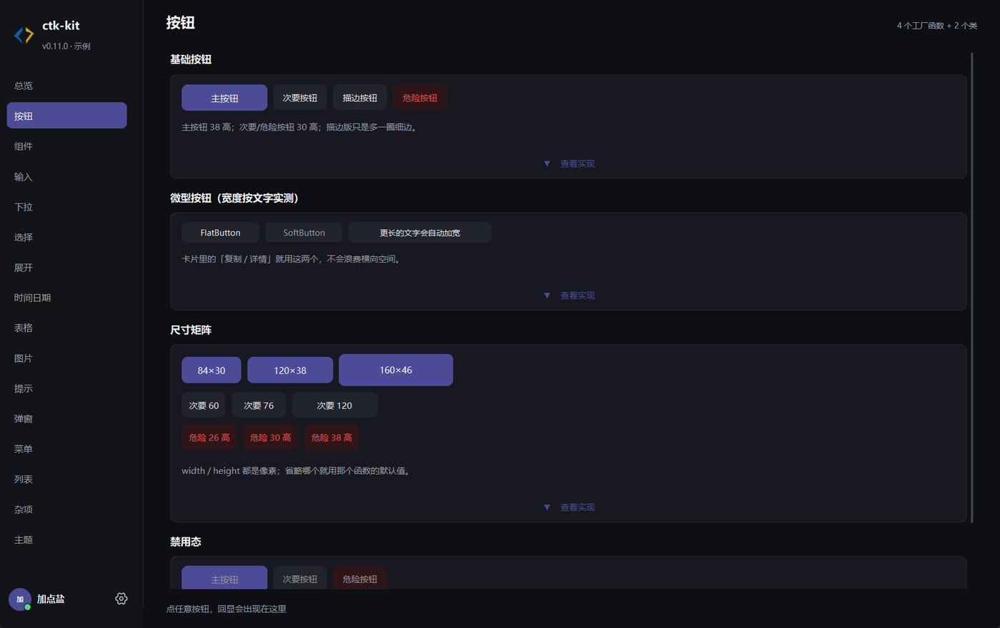

# ctk-kit

[](https://dashsalter.github.io/ctk-kit/)
[](https://github.com/DashSalter/ctk-kit/actions/workflows/ci.yml)
[](https://pypi.org/project/ctk-kit/)
[](https://pypi.org/project/ctk-kit/)
[](LICENSE)

> 一个用来做「正经桌面工具」的 Python UI 库：控件全部自绘、换色即时生效、
> 页面多了也不卡，在 Windows 11 上还能用上系统的毛玻璃材质。

📖 **完整文档：<https://dashsalter.github.io/ctk-kit/>** —— 每个控件的参数、方法和可复制示例都在那里。



## 三句话

- **好看**：不用 ttk 的系统原生控件，按钮、输入、下拉、表格全部自己画，圆角、悬停、
  禁用态是设计过的，不是系统默认样子。
- **能撑住规模**：内置的页面体系专为「几十个页面、几千个控件」设计，切页不白屏、
  换色只重画看得见的部分、关窗不用等。
- **改一次就全变**：颜色、圆角、间距都来自一套令牌，改一个值全窗生效，不用重启。

## 优势

### 视觉是同源的，不是拼出来的

整体是低饱和深色 + 圆角卡片：卡片 10px 圆角、控件 8px、强调色只用在主按钮和选中的
那一项上。大部分 Tkinter 项目最后都长这样——按钮方角、输入框系统凹槽、弹出面板另一套
配色；ctk-kit 的每个控件都从同一份设计令牌取色、取圆角、取字号，所以深浅色、强调色、
禁用态在所有控件上是一致的。附带的结果是：**改品牌色只需要改一个令牌**。

### 为多页面应用做过性能工程

这是它和多数 Tk 组件库最不一样的地方——性能不是顺手优化，而是设计前提：

| 问题 | 做法 |
| --- | --- |
| 切页整窗冻结 | 每页先出页头与首卡，其余按 12 ms 时间片分帧建 |
| 第二次进同一页还慢 | 空闲时按顺序预建相邻页，回去通常直接显示 |
| 换色卡住 | 只重画当前可见页，其余页记版本号，切回来时补画 |
| 页面多了拖窗口卡 | 拖拽边框开始时销毁看不见的页面，松手后按需重建 |
| 关窗等两三秒 | 交给 Tcl 一次性拆树，3000 控件约 0.36 s |

示例程序（18 个页面、3000+ 控件）实测：换色从 740 ms 降到 134 ms，最重的一页从
1.7 s 全窗冻结变成首帧 190–440 ms 可交互。

### Windows 11 的材质是真用了系统能力

只有四种主题，名字固定：**Mica**（默认，只糊壁纸）、**Frosted**（毛玻璃，透出桌面）、
**Dark**（纯深色实底）、**Acrylic**（黑色偏蓝的亚克力）。`app.set_theme("Frosted")`
一行切换，外观、合成方式、tint、暗化系数一次改好。标题栏可以交还给 DWM，让玻璃真正
糊上去；窗口圆角、边框色、标题栏图标与文字的显隐都能单独控制，甚至能把右上角的
最小化、最大化按键单独藏起来。非 Windows 平台自动退化为纯色底，不会崩。

### 页面体系是内置的

`PageBase` + `SidebarNav` 直接把「左侧导航 + 右侧多页」这套结构做完了：页面类声明
`cards_first` 决定首屏出几张卡，框架负责构建调度、切页、预建、换色补画、回收看不见的
页面。你只管写「这一页有哪些卡片」。

### 语义统一

- 所有取值型控件都支持 `set_value()` / `get_value()`（`set()` / `get()` 是简写）；
- 所有输入类都支持 `readonly=`，只读时键盘拒、下拉不开、按钮置灰，但程序写入仍然有效，
  需要临时写一次用 `with widget.unlocked():`；
- 事件回调统一成 `on_click` / `on_change` / `on_key` 这一套，不用记 Tk 的 `bind` 细节。

## 能做什么

覆盖的是「桌面工具」的常见组成，而不是玩具控件集：

| 场景 | 拿什么做 |
| --- | --- |
| 表单与设置页 | 输入框、密码框、步进器、开关、单选、分段、滑块、路径选择 |
| 数据与配置 | 表格、树形视图、分页、懒加载长列表、标签选择、树形下拉 |
| 引导与流程 | 步骤条、向导、面包屑、标签页、菜单栏 |
| 操作反馈 | 模态对话框、确认、输入弹窗、轻提示、桌面通知、进度条、环形进度、加载遮罩 |
| 内容展示 | 图片查看器、头像、轮播、代码面板、时间轴、折叠面板、分割面板 |
| 选择与输入增强 | 日期选择、时间选择、取色器、搜索框、范围滑块 |
| 窗口本身 | 毛玻璃材质、圆角、边框、标题栏元素与按键显隐、页面切换 |

## 和同类比

| | 原生 Tkinter / ttk | 直接用 CustomTkinter | ctk-kit |
| --- | --- | --- | --- |
| 控件外观 | 系统原生，改不动 | 部分自绘 | 全部自绘，同一套令牌 |
| 换主题 | 逐控件改 | 逐个控件改 | 改令牌，全窗即时生效 |
| 深色模式 | 两套颜色 | 两套颜色 | 令牌只有一套 |
| 页面切换 | 白屏 / 重建 | 自己处理 | 分帧 + 预建 + 不冻结 |
| 窗口质感 | 方角白底 | 纯色 | Mica / 亚克力 / 毛玻璃 |
| 只读语义 | 要自己拼 | 不统一 | 全输入类统一 `readonly` |

## 安装

```bash
pip install ctk-kit
```

依赖 `customtkinter`（自绘控件底座）与 `Pillow`（勾选/单选指示符、进度条圆弧、
图片查看器），纯 Python，支持 Python 3.9 – 3.14。

**核心库不含任何持久化代码**：窗口大小、位置、主题要不要记住、记在哪、用什么格式，
都由你自己的项目决定；把你写好的存储对象传给 `App(state=...)` 即可（接口见文档站的
`App` 一节）。仓库里的示例用 `conf_base` 演示这件事，需要额外装：
`pip install ctk-kit[demo]`。

毛玻璃相关能力依赖 Windows 11 的 DWM，其他平台自动降级。

## 快速开始

```python
import ctk_kit as ctk

app = ctk.App(title="全部记录", size=(880, 560))

header = ctk.PageHeader(app, "全部记录")
header.info.configure(text="共 12 条")
header.pack(fill="x", padx=20, pady=(16, 8))

box = ctk.Card(app)
box.pack(fill="x", padx=20)
ctk.PrimaryButton(box, "新建", lambda: app.notify("已保存")).pack(padx=16, pady=16)

app.mainloop()
```

看全部控件的实际效果：

```bash
python examples/basics/window.py
```

## 文档

组件清单、构造参数、方法与可运行示例都在文档站：

**<https://dashsalter.github.io/ctk-kit/>**

- GitHub：<https://github.com/DashSalter/ctk-kit>
- Gitee：<https://gitee.com/kuangjianke/ctk-kit>
- PyPI：<https://pypi.org/project/ctk-kit/>

## License

MIT
