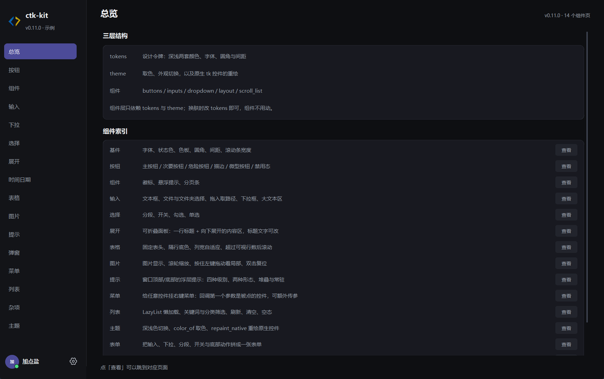
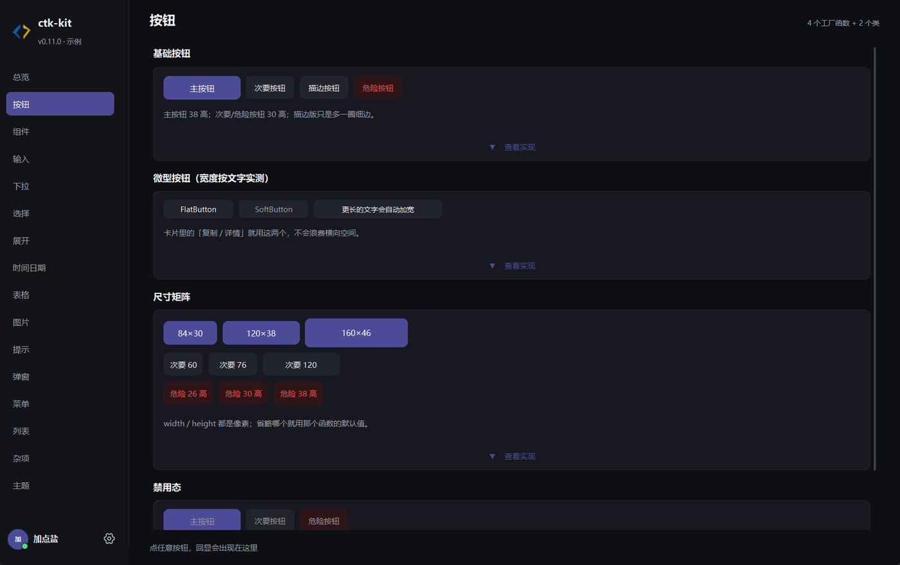
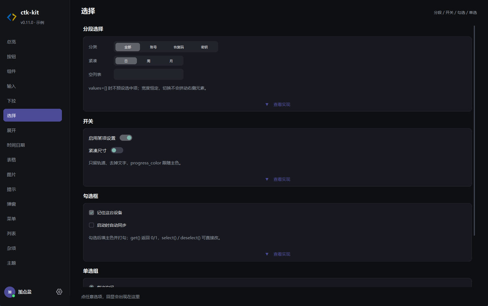
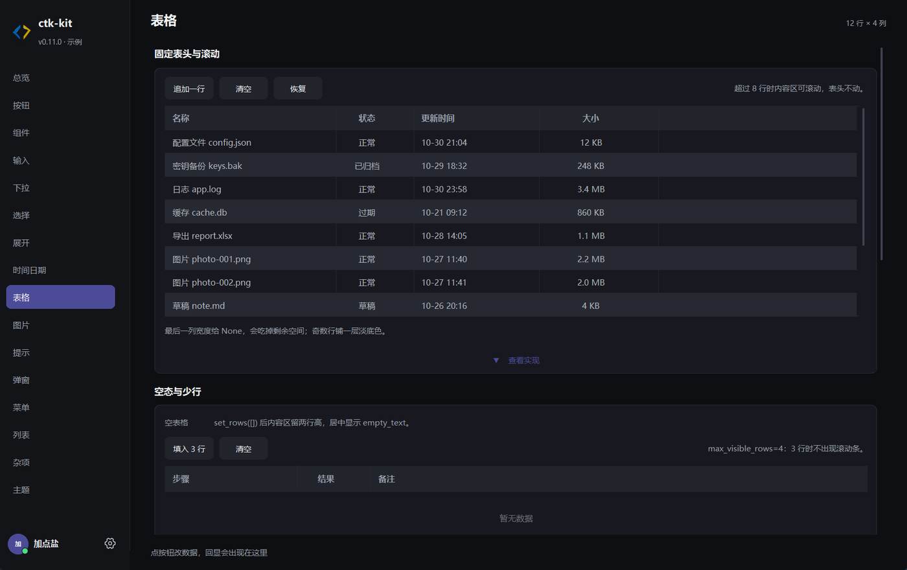
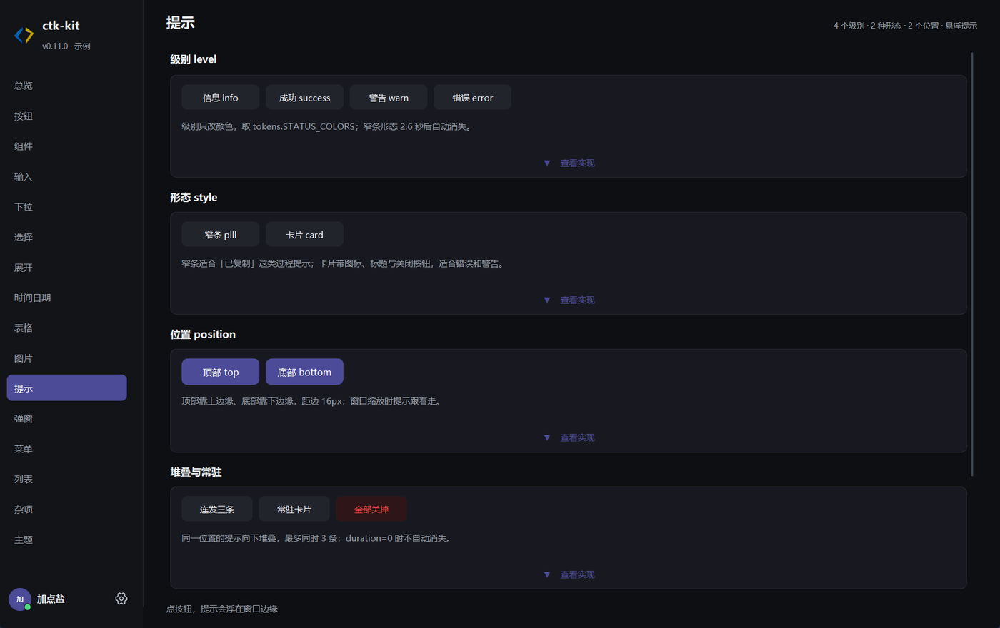
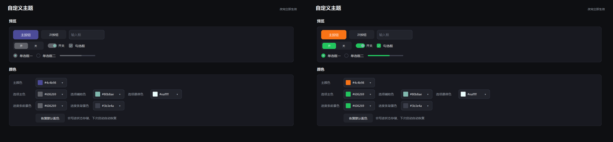
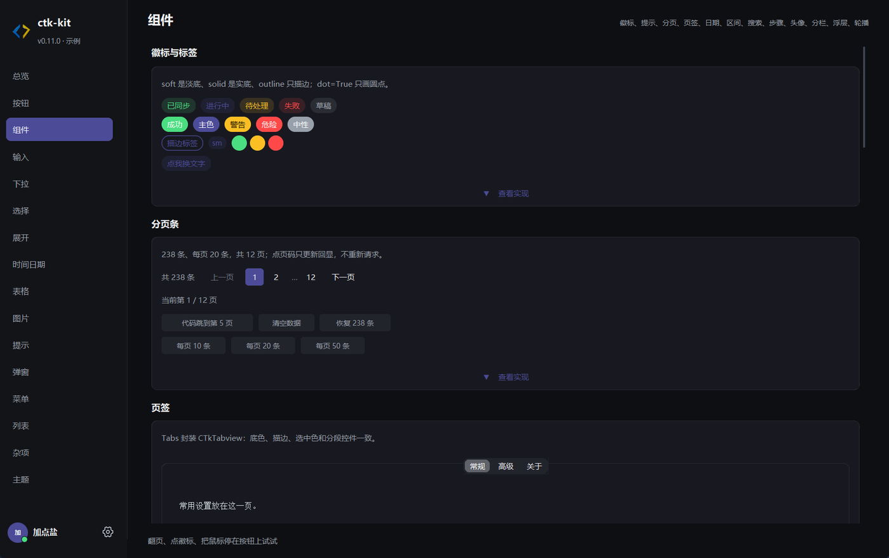
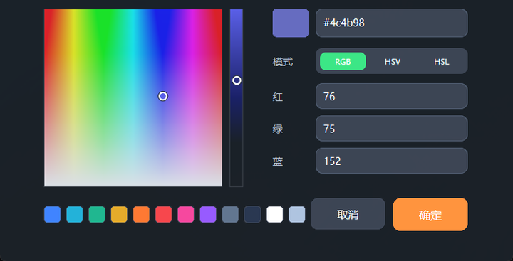

# 我把 Python 桌面 UI 卷到了这个程度：ctk-kit，一套不像 Tkinter 的组件库

> 60 多个控件与变体、毛玻璃背景、实时换主题、完整取色器。全部纯 Python，`pip install` 即用。

如果你也经历过这些，这篇可能是写给你的：

- 用 Tkinter 写完功能，一运行，界面像 2005 年的软件；
- 换成 ttk / ttkbootstrap，控件是能看了，但想改个圆角、加个毛玻璃、做个分段选择器，还是要自己画；
- 用 PyQt / Electron，包体一下几十上百 MB，只想做个小工具，代价太大。

我花了很长时间做一件事：**在纯 Tkinter 的技术栈上，把界面做到「有设计感」**。成果就是下面这个项目 —— ctk-kit。



它基于 [CustomTkinter](https://github.com/TomSchimansky/CustomTkinter)，但没有停在「换个深色皮肤」这一步：颜色令牌、间距、圆角、自绘控件、浮层、动画，全都重新做过一遍。

---

## 一、它到底长什么样

先看几个真实截图，全部来自仓库自带的示例程序，没有 P 图。

**按钮与尺寸矩阵**



**分段选择、开关、勾选框、单选**



**表格（固定表头、隔行底色、列宽自适应）**



**通知系统（四种级别、两种形态、堆叠与常驻）**



这些界面有一个共同点：**所有控件都共用同一套设计语言**。圆角是同一个数值，间距是同一套刻度，颜色全部来自同一组令牌。不是东拼西凑的「能用」，而是看起来像一个产品。

---

## 二、Tkinter 为什么做不出这种界面

不是 Tkinter 不行，是它太老了。四个具体问题：

1. **控件样式能力弱**。原生 `ttk` 的主题是系统级样式表，改一个按钮的圆角要重写整个主题；想给开关做一个「圆球滑过去」的效果，基本没门。
2. **没有统一的设计令牌**。颜色、间距、字体散落在每个 `configure()` 里，想整体调一下主色，得全局搜字符串。
3. **浮层、动画、阴影全靠手写**。下拉面板、右键菜单、提示、对话框，每个都要自己算位置、自己处理失焦关闭。
4. **高分屏和圆角是坑**。DPI 缩放错位、窗口圆角裁不干净，做出来的东西总差一口气。

ctk-kit 就是把这四件事一次性解决掉。

---

## 三、好看在哪：四个设计决策

### 1. 颜色只有一套，但改起来是实时的

项目只有**一套毛玻璃配色**，所有颜色都是 `tokens` 里的字符串常量：

```python
COLOR_BG      = "#0e0f12"   # 窗口底
COLOR_CARD    = "#181920"   # 卡片底
COLOR_ACCENT  = "#3E4059"   # 主按钮
COLOR_ACTIVE  = "#606269"   # 选中块、开关、勾选
```

改主题不需要重启，也不需要重建页面：

```python
from ctk_kit import theming

theming.apply_palette({
    "COLOR_ACCENT": "#f97316",   # 主按钮变橙
    "COLOR_ACTIVE": "#22c55e",   # 选项主色变绿
})
```

窗口里**已经存在的控件**会立刻换色，包括用 Canvas 和 Pillow 自绘的开关、滑块、分段选择器 —— 这是我认为它和大多数「换肤库」最大的区别。



左：默认配色。右：改了两个令牌之后。注意分段选择、开关、勾选、单选、进度条全都跟着变了。

不想要了？

```python
theming.reset_palette()   # 一键回到默认
```

### 2. 毛玻璃不是贴图，是系统级合成

在 Windows 11 上，窗口底层用的是 DWM 的 Acrylic / Mica 合成。卡片、输入框这些实色控件浮在玻璃上，窗口边缘是真正的圆角。

内置四套主题：**毛玻璃 / 深空 / Acrylic / Mica**。切换只改合成方式和 tint，不动控件本身：

```python
app.set_glass_options(kind="acrylic", color="#181A20")
```

### 3. 控件是画出来的，不是拼出来的

开关、勾选、单选、滑块、进度条、分段选择器、圆环进度，全部是自绘的。这意味着：

- 颜色跟着令牌走，能实时变；
- 圆角、描边、阴影可调；
- 高分屏下按 DPI 缩放，不会糊。

比如开关，关闭态、开启态、悬停态是分别绘制的，圆球颜色、轨道混色都有独立令牌。

### 4. 交互细节是统一实现的

这一点最容易被忽略，但最影响「像不像一个正经产品」：

- 大部分控件都有 hover / focus / disabled 三种状态；
- 下拉面板、右键菜单、悬浮提示用同一套浮层样式和同一套颜色；
- 通知会自动堆叠、避让、淡入淡出；
- 取色面板带色盘、明度条、RGB/HSV/HSL 三种模式、12 个参考色。

---

## 四、功能清单

项目有 **54 个模块、2.1 万行 Python、128 个公开名字**。按功能分：

| 分类 | 组件 |
| --- | --- |
| 基础 | `App`（根窗口）、`Frame`、`Card`、`PageHeader`、`Scrollable`、分割线 |
| 按钮 | `PrimaryButton`、`SecondaryButton`、`DangerButton`、`FlatButton`、`SoftButton` |
| 输入 | `FormEntry`、`TextArea`、`Checkbox`、`Switch`、`Slider`、`Segmented`、`Spinner`、`ProgressBar` |
| 选择 | `Radio`、`Check`、`DropField`、`TagSelectField`、`TreeSelectField`、`Stepper` |
| 数据展示 | `Table`、`TreeView`、`LazyList`、`Pagination`、`Tabs`、`Timeline`、`Breadcrumb` |
| 日期时间 | `Calendar`、`DatePicker`、`TimeField`、`TimePicker` |
| 反馈 | `Notifier` / `notify`、`Tooltip`、`LoadingOverlay`、`Skeleton`、`Progress`、`RingProgress` |
| 浮层 | `Dialog`、`Popover`、`ContextMenu`、`MenuBar`、`ColorPicker` / `ColorDialog` |
| 布局 | `Splitter`、`Collapsible`、`Wizard`、`Steps`、`Carousel` |
| 媒体 | `ImageViewer`、`Avatar`、`Badge`、`Tag` |
| 导航 | `SidebarNav`、`PageBase`、`PageRebuilder` |



---

## 五、上手：十行跑起来

安装：

```bash
pip install ctk-kit
```

最小示例：

```python
from ctk_kit import App, Card, PageHeader, PrimaryButton

app = App(title="全部记录", size=(880, 560), appearance="dark")

header = PageHeader(app, "全部记录")
header.info.configure(text="共 12 条")
header.pack(fill="x", padx=20, pady=(16, 8))

box = Card(app)
box.pack(fill="x", padx=20, pady=8)
PrimaryButton(box, "新建", lambda: app.notify("已保存")).pack(padx=16, pady=16)

app.mainloop()
```

跑起来就是一个带标题栏、卡片、主按钮、通知的窗口，不需要自己拼样式。

想看完整体验，直接跑仓库里的示例：

```bash
python examples/basics/window.py
```

示例有 **16 个页面**，大部分卡片都带「查看实现」的折叠代码块，可以直接抄。

---

## 六、几个我自己最常用的能力

### 完整取色器

不是简单的色板，是带色盘、明度条、三种色彩模式、参考色的完整面板。右键菜单还能复制 / 粘贴颜色（剪贴板不是合法颜色时，粘贴项会自动灰掉）。



```python
from ctk_kit import ColorPicker

picker = ColorPicker(parent, value="#4c4b98", command=lambda c: print(c))
```

### 表格

固定表头、隔行底色、列宽自适应、超过行数自动滚动、空数据占位，开箱即用。树形数据用 `TreeView`，同样是一套配色。

```python
from ctk_kit import Table

table = Table(parent, [("名称", None), ("状态", 120), ("大小", 100)])
table.set_rows([
    ["config.json", "正常", "12 KB"],
    ["keys.bak", "已归档", "248 KB"],
])
```

### 悬浮提示

浮层样式和下拉面板、右键菜单完全一致，不用系统毛玻璃（一小块浮层糊了背景反而看不清）。


```python
from ctk_kit import Tooltip

Tooltip(save_button, "保存当前草稿")
Tooltip(entry, lambda: f"当前长度 {len(entry.get())}", delay=300)
```

---

## 七、和别的方案比，它适合谁

公平地说，它不是万能的：

| 方案 | 优点 | 代价 |
| --- | --- | --- |
| 原生 Tkinter / ttk | 零依赖、包最小 | 界面停留在系统样式，定制成本极高 |
| ttkbootstrap | 主题多、生态成熟 | 本质还是 ttk 样式表，自绘控件和实时换色做不了 |
| **ctk-kit** | 自绘控件、实时换色、毛玻璃、组件全 | 只有一套深色配色；毛玻璃依赖 Windows 11 |
| PyQt / PySide | 能力最强、控件最全 | 包体大、License 需注意、学习曲线陡 |
| Electron / Tauri | Web 生态、界面自由 | 体积和内存代价大，纯 Python 项目集成麻烦 |

**它适合你，如果**：你在写内部工具、小工具、原型、教学项目，希望几十行代码就有产品级的界面，又不想引入几十 MB 的运行时。

**它可能不适合你，如果**：你需要多套配色同时存在、需要跨平台一致的毛玻璃效果、或者需要极其复杂的数据网格。

---

## 八、项目地址

- Gitee：<https://gitee.com/kuangjianke/ctk-kit>
- PyPI：<https://pypi.org/project/ctk-kit/>
- 示例：`python examples/basics/window.py`

当前版本 **0.11.0**，支持 Python 3.8 – 3.14，依赖只有 Pillow 和 conf_base。

如果这个项目对你的界面有一点帮助，欢迎 star；有想要的控件，也可以直接提 issue —— 示例里那 16 个页面就是按「一个控件一页」组织的，加东西很快。

---

*本文所有截图都来自 ctk-kit 自带的示例程序，欢迎自己跑一遍对比。*
