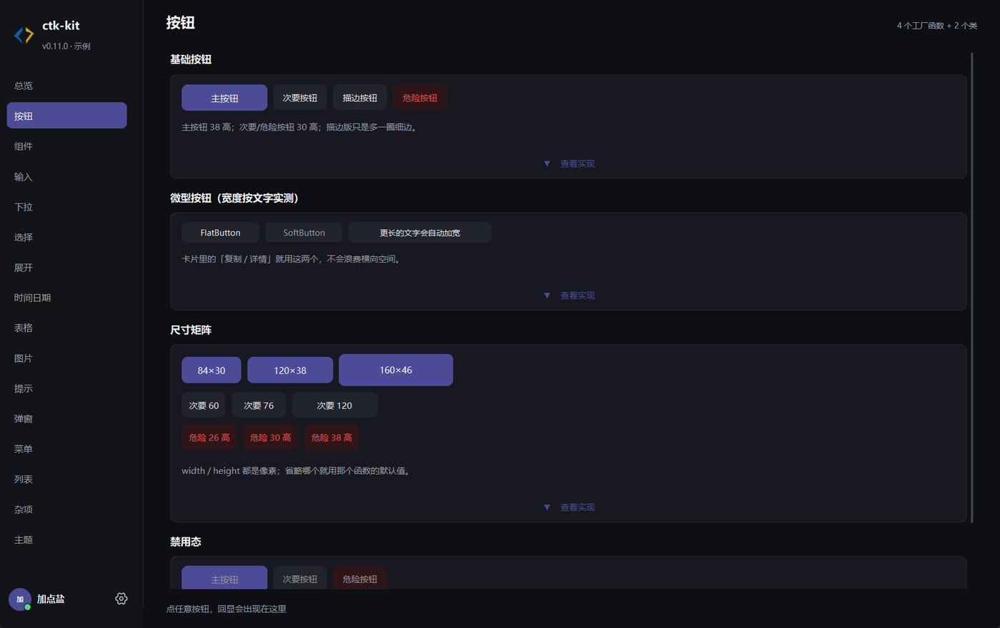

# 按钮

ctk-kit 的按钮分成两层：

- **`CTkButton`**：带库默认样式的按钮类，参数和 `customtkinter.CTkButton` 完全一致，只是默认值换成了库的规格；
- **四个工厂函数**：`PrimaryButton` / `SecondaryButton` / `DangerButton`，以及卡片里用的 `FlatButton` / `SoftButton`。

所有工厂函数**只负责创建，不负责摆位** —— 拿到的都是普通的 `ctk.CTkButton`，用 `pack()` / `grid()` / `place()` 自己放。

{ loading=lazy }

## 选哪个

| 类型 | 高度 | 圆角 | 用在哪 |
| --- | --- | --- | --- |
| `PrimaryButton` | 38 | 9 | 一屏里最重要的那个动作：保存、搜索、立即备份 |
| `SecondaryButton` | 30 | 8 | 并列动作：取消、刷新、选择目录 |
| `DangerButton` | 30 | 8 | 删除、清空这类不可逆动作 |
| `FlatButton` | 按文字算 | 8 | 卡片角落的「复制 / 显示 / 详情」 |
| `SoftButton` | 按文字算 | 6 | 比 `FlatButton` 更安静，灰字小按钮 |

!!! tip "高度决定圆角"
    `SecondaryButton` 的高度超过 30 时，圆角会自动从 8 加到 9，避免又高又方的观感。

## 公共参数

`CTkButton` 覆盖了这些默认值，其余参数透传给 `customtkinter.CTkButton`：

| 参数 | 类型 | 默认值 | 说明 |
| --- | --- | --- | --- |
| `master` | `tk.Misc` | 必填 | 父容器 |
| `text` | `str` | `"CTkButton"` | 按钮文字 |
| `command` | `Callable[[], None]` | `None` | 点击回调，**不接收事件对象** |
| `width` | `int` | `140` | 宽度（像素） |
| `height` | `int` | `38` | 高度（像素） |
| `corner_radius` | `int` | `9` | 圆角半径 |
| `border_width` | `int` | `0` | 边框宽度 |
| `border_spacing` | `int` | `10` | 文字与边框的内缩 |
| `bg_color` | `str` | `"transparent"` | 父容器底色（一般不用传） |
| `fg_color` | `str` | `COLOR_SOFT` | 常态底色 |
| `hover_color` | `str` | `COLOR_SOFT_HOVER` | 悬停底色 |
| `border_color` | `str` | `COLOR_BORDER` | 边框颜色 |
| `text_color` | `str` | `COLOR_TEXT` | 文字颜色 |
| `text_color_disabled` | `str` | CustomTkinter 默认 | 禁用态文字颜色 |
| `font` | `tuple \| CTkFont` | `FONT_BODY` | `("微软雅黑", 13)` |
| `state` | `str` | `"normal"` | `"normal"` / `"disabled"` |
| `hover` | `bool` | `True` | 是否响应悬停 |
| `image` | `CTkImage` | `None` | 图标 |
| `compound` | `str` | `"left"` | 图标与文字的位置关系 |
| `textvariable` | `tk.Variable` | `None` | 用变量驱动文字 |

颜色参数既可以直接传 `"#RRGGBB"`，也可以传 `ctk_kit.tokens` 里的令牌（例如 `COLOR_ACCENT`）。

## 工厂函数

### PrimaryButton

```python
PrimaryButton(
    master,
    text,
    command=None,
    *,
    width=120,
    height=38,
    radius=9,
    font=FONT_BODY,
) -> ctk.CTkButton
```

强调色主按钮：`COLOR_ACCENT` 底 + `COLOR_ACCENT_TEXT` 字，悬停用 `COLOR_ACCENT_HOVER`。

| 参数 | 类型 | 默认值 | 说明 |
| --- | --- | --- | --- |
| `master` | `tk.Misc` | 必填 | 父容器 |
| `text` | `str` | 必填 | 按钮文字 |
| `command` | `Callable[[], None]` | `None` | 点击回调 |
| `width` | `int` | `120` | 宽度 |
| `height` | `int` | `38` | 高度 |
| `radius` | `int` | `9` | 圆角 |
| `font` | `tuple` | `FONT_BODY` | 字体 |

```python
ctk.PrimaryButton(row, "保存", command=save).pack(side="left")
```

### SecondaryButton

```python
SecondaryButton(
    master,
    text,
    command=None,
    *,
    width=76,
    height=30,
    font=FONT_SMALL,
    border=False,
) -> ctk.CTkButton
```

浅底次要按钮。`border=True` 时加一圈 1px 的 `COLOR_BORDER` 细边，适合「取消 / 清除」这类不该抢视线的动作。

| 参数 | 类型 | 默认值 | 说明 |
| --- | --- | --- | --- |
| `master` | `tk.Misc` | 必填 | 父容器 |
| `text` | `str` | 必填 | 按钮文字 |
| `command` | `Callable[[], None]` | `None` | 点击回调 |
| `width` | `int` | `76` | 宽度 |
| `height` | `int` | `30` | 高度，超过 30 时圆角自动 +1 |
| `font` | `tuple` | `FONT_SMALL` | `("微软雅黑", 12)` |
| `border` | `bool` | `False` | 是否画 1px 边框 |

```python
ctk.SecondaryButton(row, "取消", command=close).pack(side="left", padx=(8, 0))
ctk.SecondaryButton(row, "清除筛选", command=clear, border=True).pack(side="left")
```

### DangerButton

```python
DangerButton(
    master,
    text,
    command=None,
    *,
    width=76,
    height=30,
    font=FONT_SMALL,
) -> ctk.CTkButton
```

淡红底 + 红字（`COLOR_DANGER_SOFT` / `COLOR_DANGER`），比纯红按钮安静，用在删除、清空全部。

| 参数 | 类型 | 默认值 | 说明 |
| --- | --- | --- | --- |
| `master` | `tk.Misc` | 必填 | 父容器 |
| `text` | `str` | 必填 | 按钮文字 |
| `command` | `Callable[[], None]` | `None` | 点击回调 |
| `width` | `int` | `76` | 宽度 |
| `height` | `int` | `30` | 高度 |
| `font` | `tuple` | `FONT_SMALL` | 字体 |

```python
ctk.DangerButton(row, "删除", command=remove).pack(side="left")
```

### FlatButton

```python
FlatButton(
    master,
    text,
    command=None,
    *,
    bg=None,
    hover=None,
    fg=None,
    font=FONT_TINY,
    padx=10,
    pady=3,
    radius=8,
) -> None
```

卡片里的小号按钮。宽度按文字实测宽度算，高度按字体行高算 —— 既不浪费横向空间，也不会把文字挤掉。

| 参数 | 类型 | 默认值 | 说明 |
| --- | --- | --- | --- |
| `master` | `tk.Misc` | 必填 | 父容器 |
| `text` | `str` | 必填 | 按钮文字，宽度由它决定 |
| `command` | `Callable[[], None]` | `None` | 点击回调 |
| `bg` | `str` | `COLOR_SOFT` | 常态底色 |
| `hover` | `str` | `COLOR_SOFT_HOVER` | 悬停底色 |
| `fg` | `str` | `COLOR_TEXT` | 文字颜色 |
| `font` | `tuple \| CTkFont` | `FONT_TINY` | `("微软雅黑", 11)` |
| `padx` | `int` | `10` | 文字左右留白 |
| `pady` | `int` | `3` | 文字上下留白 |
| `radius` | `int` | `8` | 圆角 |

```python
ctk.FlatButton(card, "复制", command=copy_text).pack(side="right", padx=(0, 8))
```

### SoftButton

```python
SoftButton(master, text, command=None) -> None
```

`FlatButton` 的「更安静」版本：灰字 `COLOR_MUTED`、更小的内边距、圆角 6。

```python
ctk.SoftButton(card, "收起").pack(side="right")
```

## 常用方法

按钮拿到的都是 `customtkinter.CTkButton` 实例，下面这些方法最常用：

| 方法 | 说明 |
| --- | --- |
| `configure(**kwargs)` / `config(**kwargs)` | 改属性，例如 `btn.configure(text="已保存", state="disabled")` |
| `cget("text")` | 读属性，颜色类属性返回当前解析后的值 |
| `invoke()` | 以编程方式触发一次点击（等价于 `command()`） |
| `bind(sequence, func)` | 绑事件，例如 `btn.bind("<Double-Button-1>", handler)` |
| `unbind(sequence)` | 解绑事件 |
| `destroy()` | 销毁控件 |
| `pack(**opts)` / `grid(**opts)` / `place(**opts)` | 摆位 |
| `winfo_width()` / `winfo_height()` | 当前实际尺寸（摆位并刷新后才准确） |

!!! note "禁用与恢复"
    ```python
    btn.configure(state="disabled")   # 变灰、不响应点击
    btn.configure(state="normal")     # 恢复
    ```

## 完整示例

```python
import ctk_kit as ctk

app = ctk.App(title="按钮示例", size=(640, 420))

card = ctk.Card(app, title="动作")
card.pack(fill="x", padx=24, pady=(24, 12))

row = ctk.Frame(card)
row.pack(fill="x", padx=16, pady=(12, 16))

ctk.PrimaryButton(row, "保存", command=lambda: print("保存")).pack(side="left")
ctk.SecondaryButton(row, "取消", command=app.destroy).pack(side="left", padx=(10, 0))
ctk.SecondaryButton(row, "清除", command=lambda: print("清除"), border=True).pack(
    side="left", padx=(10, 0)
)
ctk.DangerButton(row, "删除", command=lambda: print("删除")).pack(side="left", padx=(10, 0))

# 卡片角落的小按钮：宽度随文字走
foot = ctk.Frame(card)
foot.pack(fill="x", padx=16, pady=(0, 14))
ctk.HintLabel(foot, "改动会立即生效").pack(side="left")
ctk.FlatButton(foot, "复制", command=lambda: print("复制")).pack(side="right")
ctk.SoftButton(foot, "收起").pack(side="right", padx=(0, 8))

app.mainloop()
```

## 换色

按钮的颜色全部来自令牌，改令牌就是改整个程序里所有按钮：

```python
from ctk_kit import theming

# 主按钮底色（同时影响强调文字、分页当前页）
theming.apply_palette({"COLOR_ACCENT": "#f97316"})

# 次要按钮、卡片底色一起用的柔和底色
theming.apply_palette({"COLOR_SOFT": "#242731"})
```

已经在界面上的按钮会立即换色，不需要重建页面 —— 走的是令牌替换表 + 每个控件的 `apply_theme()`，canvas 自绘的部分也会跟着重画。
