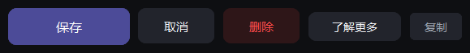

# 按钮

{ loading=lazy }

## 作用

一句话：点了会执行一件事的方块。主按钮用于「保存 / 确定」，次按钮用于「取消」，
危险按钮用于删除这类不可逆操作。

## PrimaryButton

### 作用

主操作按钮：实心主色底、白色文字，一屏里通常只放一个。

### 参数

| 参数 | 类型 | 默认值 | 说明 |
| --- | --- | --- | --- |
| `master` | `tk.Misc` | 必填 | 父容器 |
| `text` | `str` | `""` | 按钮文字 |
| `command` | `Callable[[], None]` | `None` | 点击回调 |
| `width` | `int` | `110` | 宽度（逻辑像素） |
| `height` | `int` | `38` | 高度 |
| `icon` | `str` | `None` | 左侧图标字符，如 `"+"` |

### 方法

| 方法 | 说明 |
| --- | --- |
| `set_text(text)` | 改文字 |
| `get_text()` | 读文字 |
| `disable()` / `enable()` | 禁用 / 启用；禁用后变灰且点不动 |
| `set_fg_color(color)` | 改底色，`"transparent"` 表示透明 |
| `on_click(fn)` | 再挂一个点击回调（可以挂多个） |

### 示例

```python
row = card.row(1)
save = PrimaryButton(row, "保存", command=lambda: print("保存"), width=96)
save.pack(side="left")

save.set_text("已保存").disable()
```

## 变体

这四个和 `PrimaryButton` 的参数、方法完全一样，只换配色，按场景挑一个即可：

| 组件 | 外观 | 用在哪 |
| --- | --- | --- |
| `SecondaryButton` | 浅底；`border=True` 时多一圈细边 | 取消、次要操作 |
| `DangerButton` | 淡红底、红字 | 删除、清空 |
| `OutlineButton` | 空心底、1px 彩色描边 | 需要边界但不想抢视线的操作 |
| `FlatButton` | 无底色，只有文字 | 工具栏、行内链接 |
| `SoftButton` | 浅色底、深色字 | 一排并列的次级操作 |

```python
row = card.row(1)
SecondaryButton(row, "取消", command=lambda: print("取消")).pack(side="left")
DangerButton(row, "删除", command=lambda: print("删除")).pack(side="left", padx=(8, 0))
OutlineButton(row, "稍后处理", tone="accent").pack(side="left", padx=(8, 0))
FlatButton(row, "了解更多", command=lambda: print("文档")).pack(side="left", padx=(8, 0))
SoftButton(row, "复制", command=lambda: print("复制")).pack(side="left", padx=(8, 0))
```

## OutlineButton

### 作用

描边按钮：空心底 + 1px 描边，文字默认用正文色；悬停只铺一层淡底，不会变成实心块。
描边颜色由 `tone` 决定，文字颜色可以用 `text_color` 单独改；`toggle=True`
时变成开关式按钮，点一下保持高亮、再点一下取消。

### 参数

| 参数 | 类型 | 默认值 | 说明 |
| --- | --- | --- | --- |
| `master` | `tk.Misc` | 必填 | 父容器 |
| `text` | `str` | 必填 | 按钮文字 |
| `command` | `Callable[[], None]` | `None` | 点击回调；toggle 时在切换之后调用 |
| `tone` | `str` | `"accent"` | `accent` 主色 / `neutral` 灰色 / `danger` 红色 |
| `text_color` | `ColorToken` | `None` | 文字颜色，默认跟随正文色 `COLOR_TEXT` |
| `toggle` | `bool` | `False` | 点击保持高亮，再点取消 |
| `width` | `int` | `76` | 宽度（逻辑像素） |
| `height` | `int` | `30` | 高度 |
| `font` | `FontSpec` | `FONT_SMALL` | 字体规格 |
| `radius` | `int` | `8` | 圆角半径 |

### 示例

```python
row = card.row(1)
pin = OutlineButton(row, "固定", toggle=True)                      # 点一下保持高亮
OutlineButton(row, "稍后处理").pack(side="left")                    # 主色描边
OutlineButton(row, "忽略", tone="neutral").pack(side="left", padx=(8, 0))     # 灰色描边
OutlineButton(row, "删除", tone="danger").pack(side="left", padx=(8, 0))      # 红色描边
OutlineButton(row, "仅描边", text_color=COLOR_DANGER).pack(side="left", padx=(8, 0))  # 只改文字色
pin.pack(side="left", padx=(8, 0))
pin.get_toggled()          # True / False
pin.set_toggled(False)     # 程序里取消高亮
```

`tone` 传其他值会抛 `ValueError`。
