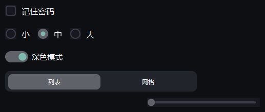

# 选择控件

{ loading=lazy }

## 作用

六个「做选择」的控件：勾选、单选、开关、分段、单值滑块、双值滑块。

> 取值型控件统一用 `get()` 读、`set(...)` 写。

## Check

### 作用

勾选框：左边一个方块，勾上出现对勾。`get()` 返回 `True` / `False`。

### 参数

| 参数 | 类型 | 默认值 | 说明 |
| --- | --- | --- | --- |
| `master` | `tk.Misc` | 必填 | 父容器 |
| `text` | `str` | `""` | 右侧文字 |
| `command` | `Callable[[], None]` | `None` | 点击回调 |
| `value` | `bool` | `False` | 初始是否勾上；`value=True` 就是默认选中 |
| `variable` | `tk.IntVar` | `None` | 自己管状态时才传 |
| `width` / `height` | `int` | `22` | 指示符尺寸 |

### 方法

| 方法 | 说明 |
| --- | --- |
| `get()` | 是否勾上 |
| `set(True/False)` | 勾上 / 取消（不触发回调） |
| `select()` / `deselect()` | 同上，旧名字 |
| `set_text(text)` | 改文字 |

### 示例

```python
agree = Check(card.body, "记住密码", command=lambda: print("切换"))
agree.pack(anchor="w", padx=16, pady=(0, 12))
print(agree.get())
```

## Radio

### 作用

单选项：圆形指示符。**同一个 `group` 里只能选中一个**，不需要自己建 `StringVar`。

### 参数

| 参数 | 类型 | 默认值 | 说明 |
| --- | --- | --- | --- |
| `master` | `tk.Misc` | 必填 | 父容器 |
| `text` | `str` | `""` | 右侧文字 |
| `value` | `str` | `""` | 选中时写进组变量的值，默认等于 `text` |
| `group` | `str` | `None` | 组名：同名的一组自动互斥 |
| `command` | `Callable[[], None]` | `None` | 点击回调 |
| `variable` | `tk.StringVar` | `None` | 需要自己管变量时再传 |

### 方法

| 方法 | 说明 |
| --- | --- |
| `get()` | 组里当前选中的值 |
| `set(value)` | 选中值为 `value` 的那一项 |
| `select()` | 选中自己 |
| `set_text(text)` | 改文字 |

### 示例

```python
for text, value in [("小", "s"), ("中", "m"), ("大", "l")]:
    Radio(row, text, value=value, group="size").pack(side="left", padx=(0, 12))

# 任意一个都能读整组的值
print(row.winfo_children()[0].get())    # 's' / 'm' / 'l'
```

## RadioGroup

### 作用

一组单选项：自动建好 `Radio` 并管互斥，读取和程序设置都走这一个控件，不用再碰组变量。

### 参数

| 参数 | 类型 | 默认值 | 说明 |
| --- | --- | --- | --- |
| `master` | `tk.Misc` | 必填 | 父容器 |
| `options` | `Sequence[str]` | 必填 | 选项文字，值默认等于文字 |
| `value` | `str` | `None` | 初始选中项 |
| `on_change` | `Callable[[str], None]` | `None` | 用户切换时回调，参数是选中的值 |
| `group` | `str` | `None` | 组名，默认自动生成 |
| `gap` | `int` | `16` | 选项之间的间距 |

### 方法

| 方法 | 说明 |
| --- | --- |
| `get()` | 当前选中的值 |
| `set(value)` | 程序设置选中项（不触发 `on_change`） |
| `on_change` | 用户切换时的回调属性，构造后也可以再赋值 |
| `bind_config(target)` | 绑定 conf_base 配置项，双向同步 |

### 示例

```python
from ctk_kit import FieldLabel, RadioGroup, Row

row = Row(card)
row.pack(fill="x", padx=16, pady=12)
FieldLabel(row, "同步").pack(side="left", anchor="nw")
RadioGroup(
    row,
    ["每次询问", "总是同步", "只同步一次"],
    value="每次询问",
    on_change=lambda value: print("选了", value),
).pack(side="left", padx=(8, 0))
```

## Switch

### 作用

开关：拨到右边表示开，`get()` 返回 `True` / `False`。

### 参数

| 参数 | 类型 | 默认值 | 说明 |
| --- | --- | --- | --- |
| `master` | `tk.Misc` | 必填 | 父容器 |
| `text` | `str` | `""` | 左侧文字 |
| `value` | `bool` | `False` | 初始状态 |
| `command` | `Callable[[bool], None]` | `None` | 切换回调，参数是新状态 |

### 方法

| 方法 | 说明 |
| --- | --- |
| `get()` / `set(bool)` | 读 / 写状态（等价于 `get()` / `set()`） |

### 示例

```python
dark = Switch(card.body, text="深色模式", value=True,
              command=lambda on: print("开" if on else "关"))
dark.pack(anchor="w", padx=16, pady=(0, 12))
```

## Segmented

### 作用

分段选择：一排紧挨着的按钮，只有一个是亮的，适合 2–4 个互斥选项。

### 参数

| 参数 | 类型 | 默认值 | 说明 |
| --- | --- | --- | --- |
| `master` | `tk.Misc` | 必填 | 父容器 |
| `values` | `Sequence[str] \| Mapping[str, Any]` | `()` | 列表：各段文字；字典：键是文字、值是数据 |
| `command` | `Callable[[Segmented], None]` | `None` | 切换回调，参数是分段控件本身 |

### 方法

| 方法 | 说明 |
| --- | --- |
| `get()` / `set(value)` | 读 / 写选中项；字典模式下 `get()` 返回选中的值 |
| `get_label()` | 当前选中段显示的文字 |
| `set_values(values)` | 换各段内容 |

### 示例

```python
seg = Segmented(
    card.body,
    values={"列表": "list", "网格": "grid"},
    command=lambda widget: print(widget.get()),   # 收到分段控件
)
seg.set("grid")
seg.pack(anchor="w", padx=16, pady=(0, 12))
```

## Slider

### 作用

单值滑块，拖动手柄或点击轨道改变数值。

### 参数

| 参数 | 类型 | 默认值 | 说明 |
| --- | --- | --- | --- |
| `master` | `tk.Misc` | 必填 | 父容器 |
| `from_` / `to` | `float` | `0` / `100` | 范围 |
| `steps` | `int` | `0` | 只允许落在整数档位 |
| `command` | `Callable[[float], None]` | `None` | 拖动回调 |
| `release_command` | `Callable[[float], None]` | `None` | 松开鼠标时的回调 |

### 方法

| 方法 | 说明 |
| --- | --- |
| `get()` / `set(value)` | 读 / 写当前值（等价于 `get()` / `set()`）；初始值用 `set()` 指定 |

### 示例

```python
volume = Slider(card.body, from_=0, to=100,
                command=lambda v: print(int(v)),
                release_command=lambda v: print("松手", int(v)))
volume.set(60)
volume.pack(fill="x", padx=16, pady=(0, 12))
```

## RangeSlider

### 作用

双值滑块：两个手柄框出一个区间，`get()` 返回 `(下限, 上限)`。

### 参数

| 参数 | 类型 | 默认值 | 说明 |
| --- | --- | --- | --- |
| `master` | `tk.Misc` | 必填 | 父容器 |
| `from_` / `to` | `float` | `0` / `100` | 范围 |
| `values` | `(float, float)` | `None` | 初始区间 |
| `step` | `float` | `0` | 档位步长，`0` 表示连续 |
| `command` | `Callable[[tuple], None]` | `None` | 拖动回调，参数是区间 |

### 方法

| 方法 | 说明 |
| --- | --- |
| `get()` / `set((low, high))` | 读 / 写区间（等价于 `get()` / `set()`） |

### 示例

```python
price = RangeSlider(card.body, from_=0, to=1000, values=(200, 600),
                    command=lambda span: print(span))
price.pack(fill="x", padx=16, pady=(0, 12))
```
