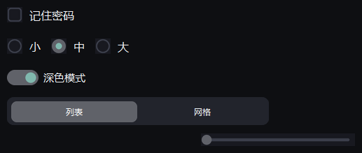

# 选择控件

{ loading=lazy }

## 作用

六个「做选择」的控件：勾选、单选、开关、分段、单值滑块、双值滑块。

## Check

### 作用

勾选框：左边一个方块，勾上出现对勾。`get_value()` 返回 `True` / `False`。

### 参数

| 参数 | 类型 | 默认值 | 说明 |
| --- | --- | --- | --- |
| `master` | `tk.Misc` | 必填 | 父容器 |
| `text` | `str` | `""` | 右侧文字 |
| `command` | `Callable[[], None]` | `None` | 点击回调 |
| `variable` | `tk.IntVar` | `None` | 自己管状态时才传 |
| `width` / `height` | `int` | `22` | 指示符尺寸 |

### 方法

| 方法 | 说明 |
| --- | --- |
| `get_value()` | 是否勾上 |
| `set_value(True/False)` | 勾上 / 取消（不触发回调） |
| `select()` / `deselect()` | 同上，旧名字 |
| `set_text(text)` | 改文字 |

### 示例

```python
agree = Check(card.body, "记住密码", command=lambda: print("切换"))
agree.pack(anchor="w", padx=16, pady=(0, 12))
print(agree.get_value())
```

## Radio

### 作用

单选项：圆形指示符。**同一个 `group` 里只能选中一个**，不需要自己建 `StringVar`。

### 参数

| 参数 | 类型 | 默认值 | 说明 |
| --- | --- | --- | --- |
| `master` | `tk.Misc` | 必填 | 父容器 |
| `text` | `str` | `""` | 右侧文字 |
| `value` | `str` | `""` | 选中时写进组变量的值，默认等于 `text` |
| `group` | `str` | `None` | 组名：同名的一组自动互斥 |
| `command` | `Callable[[], None]` | `None` | 点击回调 |
| `variable` | `tk.StringVar` | `None` | 需要自己管变量时再传 |

### 方法

| 方法 | 说明 |
| --- | --- |
| `get_value()` | 组里当前选中的值 |
| `set_value(value)` | 选中值为 `value` 的那一项 |
| `select()` | 选中自己 |
| `set_text(text)` | 改文字 |

### 示例

```python
for text, value in [("小", "s"), ("中", "m"), ("大", "l")]:
    Radio(row, text, value=value, group="size").pack(side="left", padx=(0, 12))

# 任意一个都能读整组的值
print(row.winfo_children()[0].get_value())    # 's' / 'm' / 'l'
```

## Switch

### 作用

开关：拨到右边表示开，`get()` 返回 `True` / `False`。

### 参数

| 参数 | 类型 | 默认值 | 说明 |
| --- | --- | --- | --- |
| `master` | `tk.Misc` | 必填 | 父容器 |
| `text` | `str` | `""` | 左侧文字 |
| `value` | `bool` | `False` | 初始状态 |
| `command` | `Callable[[bool], None]` | `None` | 切换回调，参数是新状态 |

### 方法

| 方法 | 说明 |
| --- | --- |
| `get()` / `set(bool)` | 读 / 写状态 |

### 示例

```python
dark = Switch(card.body, text="深色模式", value=True,
              command=lambda on: print("开" if on else "关"))
dark.pack(anchor="w", padx=16, pady=(0, 12))
```

## Segmented

### 作用

分段选择：一排紧挨着的按钮，只有一个是亮的，适合 2–4 个互斥选项。

### 参数

| 参数 | 类型 | 默认值 | 说明 |
| --- | --- | --- | --- |
| `master` | `tk.Misc` | 必填 | 父容器 |
| `values` | `Sequence[str]` | `()` | 各段文字 |
| `command` | `Callable[[str], None]` | `None` | 切换回调 |

### 方法

| 方法 | 说明 |
| --- | --- |
| `get()` / `set(value)` | 读 / 写选中项；初始值用 `set()` 指定 |
| `set_values(values)` | 换各段文字 |

### 示例

```python
seg = Segmented(card.body, values=["列表", "网格"])
seg.set("列表")
seg.pack(anchor="w", padx=16, pady=(0, 12))
```

## Slider

### 作用

单值滑块，拖动手柄或点击轨道改变数值。

### 参数

| 参数 | 类型 | 默认值 | 说明 |
| --- | --- | --- | --- |
| `master` | `tk.Misc` | 必填 | 父容器 |
| `from_` / `to` | `float` | `0` / `100` | 范围 |
| `steps` | `int` | `0` | 只允许落在整数档位 |
| `command` | `Callable[[float], None]` | `None` | 拖动回调 |

### 方法

| 方法 | 说明 |
| --- | --- |
| `get()` / `set(value)` | 读 / 写当前值；初始值用 `set()` 指定 |

### 示例

```python
volume = Slider(card.body, from_=0, to=100,
                command=lambda v: print(int(v)))
volume.set(60)
volume.pack(fill="x", padx=16, pady=(0, 12))
```

## RangeSlider

### 作用

双值滑块：两个手柄框出一个区间，`get()` 返回 `(下限, 上限)`。

### 参数

| 参数 | 类型 | 默认值 | 说明 |
| --- | --- | --- | --- |
| `master` | `tk.Misc` | 必填 | 父容器 |
| `from_` / `to` | `float` | `0` / `100` | 范围 |
| `values` | `(float, float)` | `None` | 初始区间 |
| `step` | `float` | `0` | 档位步长，`0` 表示连续 |
| `command` | `Callable[[tuple], None]` | `None` | 拖动回调，参数是区间 |

### 方法

| 方法 | 说明 |
| --- | --- |
| `get()` / `set((low, high))` | 读 / 写区间 |

### 示例

```python
price = RangeSlider(card.body, from_=0, to=1000, values=(200, 600),
                    command=lambda span: print(span))
price.pack(fill="x", padx=16, pady=(0, 12))
```
