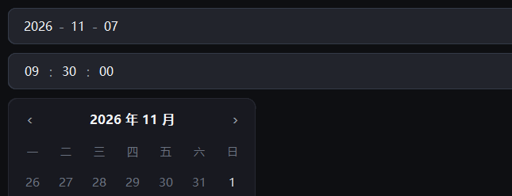

# 日期时间

{ loading=lazy }

## 作用

四个日期时间控件：日期输入、时间输入、月历、时间滚轮。

## DatePicker

### 作用

年月日三段输入，点右侧三角形弹出月历；三段也可以直接键入，回车或失焦时生效。
只读时不能键入、也点不开弹层。

### 参数

| 参数 | 类型 | 默认值 | 说明 |
| --- | --- | --- | --- |
| `master` | `tk.Misc` | 必填 | 父容器 |
| `value` | `datetime.date` | `None` | 初始日期 |
| `command` | `Callable[[date], None]` | `None` | 选中回调 |
| `width` | `int` | `200` | 整体宽度 |
| `readonly` | `bool` | `False` | 只读 |

### 方法

| 方法 | 说明 |
| --- | --- |
| `get()` / `set(date)` | 读 / 写日期，`set(None)` 清空 |
| `set_readonly(flag)` | 只读开关 |
| `open()` / `close()` | 手动开 / 关月历 |

### 示例

```python
from datetime import date

picker = DatePicker(card.body, value=date(2026, 11, 7),
                    command=lambda d: print("选了", d))
picker.pack(fill="x", padx=16, pady=(0, 12))

picker.set(None)          # 清空
picker.set(date(2026, 1, 1))
```

## TimeField

### 作用

时分秒三段输入，点右侧三角形弹出时间滚轮；三段可直接键入，越界值会被夹回
（如 99 点变成 23 点）。用法与 `DatePicker` 一致。

### 参数

| 参数 | 类型 | 默认值 | 说明 |
| --- | --- | --- | --- |
| `master` | `tk.Misc` | 必填 | 父容器 |
| `value` | `datetime.time` | `None` | 初始时间 |
| `command` | `Callable[[time], None]` | `None` | 选中回调 |
| `width` | `int` | `200` | 整体宽度 |
| `readonly` | `bool` | `False` | 只读 |

### 方法

| 方法 | 说明 |
| --- | --- |
| `get()` / `set(time)` | 读 / 写时间 |
| `set_readonly(flag)` | 只读开关 |

### 示例

```python
from datetime import time

field = TimeField(card.body, value=time(9, 30))
field.pack(fill="x", padx=16, pady=(0, 12))
```

## Calendar

### 作用

单独的月历面板，可以直接嵌在页面里用（`DatePicker` 的弹层里就是它）。

### 参数

| 参数 | 类型 | 默认值 | 说明 |
| --- | --- | --- | --- |
| `master` | `tk.Misc` | 必填 | 父容器 |
| `value` | `date` | `None` | 初始月份与选中日 |
| `command` | `Callable[[date], None]` | `None` | 选中回调 |
| `week_start` | `int` | `0` | 一周从周几开始，0 是周一 |

### 方法

| 方法 | 说明 |
| --- | --- |
| `get()` / `set(date)` | 读 / 写选中日期 |
| `prev_month()` / `next_month()` | 翻月 |

### 示例

```python
from datetime import date

cal = Calendar(card.body, value=date.today())
cal.pack(padx=16, pady=(0, 12))
cal.next_month()
```

## TimePicker

### 作用

三列时间滚轮（时 / 分 / 秒），上下拖动选择，适合放在弹层或侧栏里。

### 参数

| 参数 | 类型 | 默认值 | 说明 |
| --- | --- | --- | --- |
| `master` | `tk.Misc` | 必填 | 父容器 |
| `value` | `time` | `None` | 初始时间 |
| `command` | `Callable[[time], None]` | `None` | 变化回调 |
| `show_seconds` | `bool` | `True` | 是否显示秒列 |

### 方法

| 方法 | 说明 |
| --- | --- |
| `get()` / `set(time)` | 读 / 写时间 |

### 示例

```python
from datetime import time

wheel = TimePicker(card.body, value=time(14, 0))
wheel.pack(padx=16, pady=(0, 12))
```
