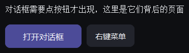

# 对话框

{ loading=lazy }

## 作用

三组东西：通用对话框 `Dialog`、三个常用的快捷弹窗、以及依附在控件上的
浮层和右键菜单。

## Dialog

### 作用

自定义对话框：标题、正文、一排按钮，点哪个就把对应返回值交回来。

### 参数

| 参数 | 类型 | 默认值 | 说明 |
| --- | --- | --- | --- |
| `master` | `tk.Misc` | 必填 | 父窗口 |
| `title` | `str` | `""` | 标题 |
| `message` | `str` | `""` | 正文 |
| `detail` | `str` | `""` | 正文下方的补充说明 |
| `level` | `str` | `"info"` | `info` / `warn` / `error`，决定图标与配色 |
| `prompt` | `str` | `None` | 传了就在正文下加一个输入框，并作为初始内容 |
| `buttons` | `Sequence[(str, Any)]` | `[("确定", True)]` | 每个是 `(文字, 返回值)`，最后一个是主按钮 |
| `width` | `int` | `392` | 宽度 |

### 方法

| 方法 | 说明 |
| --- | --- |
| `show()` | 弹出并阻塞，返回被点按钮的返回值 |
| `close(value)` | 用指定返回值关闭 |

### 示例

```python
answer = Dialog(
    app,
    title="删除项目",
    message="删除后无法恢复，确定吗？",
    level="warn",
    buttons=[("取消", False), ("删除", True)],
).show()

if answer:
    print("执行删除")
```

## Alert

### 作用

只有一个「知道了」的提示框，用于告知结果。对应函数 `alert(...)`，没有返回值。

### 示例

```python
alert(app, "已保存", detail="改动会在下次切换页面时生效")
```

## Confirm

### 作用

「确定 / 取消」二选一，返回 `True` / `False`，用在危险操作之前。

### 参数

| 参数 | 类型 | 默认值 | 说明 |
| --- | --- | --- | --- |
| `master` | `tk.Misc` | 必填 | 父窗口 |
| `message` | `str` | 必填 | 正文 |
| `title` | `str` | `""` | 标题 |
| `detail` | `str` | `""` | 补充说明 |
| `level` | `str` | `"warn"` | 图标与配色 |
| `ok` | `str` | `"确定"` | 主按钮文字 |
| `cancel` | `str` | `"取消"` | 次按钮文字 |
| `danger` | `bool` | `False` | 主按钮用红色 |

### 示例

```python
if confirm(app, "清空缓存？", detail="所有页面下次进会重新加载", danger=True):
    print("已清空")
```

## Prompt

### 作用

一个输入框 + 确定 / 取消，返回输入的文字；取消返回 `None`。

### 参数

| 参数 | 类型 | 默认值 | 说明 |
| --- | --- | --- | --- |
| `master` | `tk.Misc` | 必填 | 父窗口 |
| `message` | `str` | 必填 | 说明文字 |
| `title` | `str` | `""` | 标题 |
| `value` | `str` | `""` | 输入框初始内容 |
| `detail` | `str` | `""` | 输入框下方的补充说明 |

### 示例

```python
name = prompt(app, "请输入新名字", title="重命名", value="未命名")
if name is not None:
    print("改成", name)
```

## Popover

### 作用

贴着某个控件弹出的浮层，点外面自动关闭；可以放任意内容。

### 参数

| 参数 | 类型 | 默认值 | 说明 |
| --- | --- | --- | --- |
| `widget` | `tk.Misc` | 必填 | 贴着哪个控件 |
| `content` | `Callable[[tk.Misc], None]` | `None` | 往浮层里填内容；不传就自己往里 `pack` |
| `width` / `height` | `int` | `240` / `None` | 尺寸 |
| `placement` | `str` | `"bottom"` | `bottom` / `top` / `right` / `left` |
| `padding` | `int` | `12` | 内容内边距 |

### 方法

| 方法 | 说明 |
| --- | --- |
| `show()` / `hide()` | 开 / 关浮层 |
| `toggle()` | 切换 |

### 示例

```python
help_button = PrimaryButton(card.body, "快捷键")
pop = Popover(help_button, width=240)
Label(pop, "Ctrl+S 保存，Ctrl+Z 撤销").pack(padx=12, pady=12)
pop.toggle()
```

## ContextMenu

### 作用

右键菜单：可以挂到任意控件上，也可以手动在坐标处弹出。

### 参数

| 参数 | 类型 | 默认值 | 说明 |
| --- | --- | --- | --- |
| `master` | `tk.Misc` | 必填 | 父窗口 |

### 方法

| 方法 | 说明 |
| --- | --- | --- |
| `add_command(label, command, *, enabled=True)` | 加一项；`label` 传 `"-"` 是分隔线 |
| `add_separator()` | 加分隔线 |
| `show(x, y, *, source=None)` | 在屏幕坐标处弹出（一般传 `event.x_root` / `event.y_root`） |
| `clear()` | 清空所有项 |

### 示例

```python
menu = ContextMenu(card.body)
menu.add_command("复制", lambda: print("复制"))
menu.add_separator()
menu.add_command("删除", lambda: print("删除"), enabled=False)

attach_menu(card.body, [("刷新", lambda: print("刷新"))])   # 右键弹出
```

## 便捷挂载

### 作用

不用自己建 `ContextMenu`，直接给输入框挂上「剪切 / 复制 / 粘贴 / 全选」。

| 函数 | 说明 |
| --- | --- |
| `attach_menu(widget, items)` | 挂一组自定义项；`items` 是 `(文字, 回调)` 列表 |
| `attach_edit_menu(widget)` | 挂标准编辑菜单 |

### 示例

```python
entry = CTkEntry(card.body)
entry.pack(fill="x")
attach_edit_menu(entry)
attach_menu(card.body, [("刷新", lambda: print("刷新")), ("导出", lambda: print("导出"))])
```
