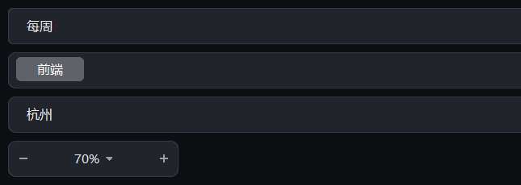

# 下拉选择

{ loading=lazy }

## 作用

四个「点开再选」的控件：普通下拉、多标签选择、树形选择、左右加减的步进器。

## DropField

### 作用

点击展开一个下拉面板，选中后写回输入框；面板底部还可以放自定义按钮。

### 参数

| 参数 | 类型 | 默认值 | 说明 |
| --- | --- | --- | --- |
| `master` | `tk.Misc` | 必填 | 父容器 |
| `values_provider` | `Callable[[], Sequence]` | 必填 | 返回候选项；每次展开都会重新调用 |
| `placeholder` | `str` | `""` | 占位文字 |
| `height` | `int` | `36` | 高度 |
| `command` | `Callable[[Any], None]` | `None` | 选中回调 |
| `disabled` | `Sequence` | `None` | 初始就置灰的项 |
| `readonly` | `bool` | `False` | 只读时点不开 |

### 方法

| 方法 | 说明 |
| --- | --- |
| `set(value)` / `get()` | 写 / 读当前值 |
| `set_values(values)` | 换候选项 |
| `open_menu()` / `close_menu()` | 手动开 / 关面板 |
| `disable(item)` / `enable(item)` | 禁用 / 恢复某一项 |
| `get_disabled()` / `clear_disabled()` | 读 / 清空被禁用的项 |

### 示例

```python
field = DropField(card.body, values_provider=lambda: ["每天", "每周", "每月"])
field.set("每周")
field.pack(fill="x", padx=16, pady=(0, 12))

field.disable("每月")            # 这一项变灰不可选
field.set("每天")
```

## TagSelectField

### 作用

多选：选项以标签形式排列，选中的标签亮起，值是选中标签组成的列表。

### 参数

| 参数 | 类型 | 默认值 | 说明 |
| --- | --- | --- | --- |
| `master` | `tk.Misc` | 必填 | 父容器 |
| `values_provider` | `Callable[[], Sequence[str]]` | 必填 | 返回全部标签；每次展开重新调用 |
| `values` | `Sequence[str]` | `None` | 初始选中的标签 |
| `command` | `Callable[[list], None]` | `None` | 选中变化回调 |
| `disabled` | `Sequence[str]` | `None` | 初始就置灰的标签 |

### 方法

| 方法 | 说明 |
| --- | --- |
| `get()` / `set(list)` | 读 / 写选中的标签 |
| `disable(tag)` / `enable(tag)` | 置灰 / 恢复某一项 |
| `get_disabled()` / `clear_disabled()` | 读 / 清空被禁用的项 |

### 示例

```python
tags = TagSelectField(
    card.body,
    values_provider=lambda: ["前端", "后端", "设计"],
    values=["前端"],
)
tags.pack(fill="x", padx=16, pady=(0, 12))
print(tags.get())        # ['前端']
```

## TreeSelectField

### 作用

树形下拉：适合「省 → 市 → 区」这种层级，点父节点展开。

### 参数

| 参数 | 类型 | 默认值 | 说明 |
| --- | --- | --- | --- |
| `master` | `tk.Misc` | 必填 | 父容器 |
| `values_provider` | `Callable[[], Sequence]` | 必填 | 返回整棵树；元素是 `"叶子"` 或 `("分组", [子项...])` |
| `value` | `str` | `""` | 初始选中的节点标题 |
| `command` | `Callable[[str], None]` | `None` | 选中回调 |
| `disabled` | `Sequence[str]` | `None` | 初始就置灰的叶节点 |

### 方法

| 方法 | 说明 |
| --- | --- |
| `get()` / `set(title)` | 读 / 写选中值 |
| `disable(title)` / `enable(title)` | 置灰 / 恢复某个叶节点 |

### 示例

```python
tree = TreeSelectField(card.body, values_provider=lambda: [
    ("浙江", [("杭州", [("西湖区", [])]), ("宁波", [])]),
    ("江苏", [("南京", [])]),
])
tree.pack(fill="x", padx=16, pady=(0, 12))
```

## Stepper

### 作用

`− 70% +` 这样的左右步进器，点击两端加减一步，也可以直接改中间的数值。

### 参数

| 参数 | 类型 | 默认值 | 说明 |
| --- | --- | --- | --- |
| `master` | `tk.Misc` | 必填 | 父容器 |
| `from_` | `float` | `0` | 最小值 |
| `to` | `float` | `100` | 最大值 |
| `increment` | `float` | `1` | 步长 |
| `value` | `float` | `None` | 初始值 |
| `suffix` | `str` | `""` | 数值后缀，如 `"%"` |
| `command` | `Callable[[float], None]` | `None` | 值变化回调 |

### 方法

| 方法 | 说明 |
| --- | --- |
| `get()` / `set(value)` | 读 / 写当前值 |
| `set_range(from_, to)` | 改范围 |

### 示例

```python
zoom = Stepper(card.body, from_=10, to=200, value=70, suffix="%")
zoom.pack(padx=16, pady=(0, 12))
```
