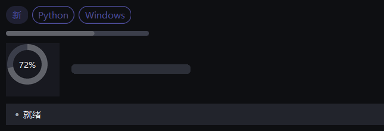

# 反馈

{ loading=lazy }

## 作用

告诉用户「正在发生什么」的一组小控件：状态角标、加载占位、进度、提示气泡、
底部状态栏和桌面通知。

## Badge

### 作用

一段彩色小标签，用来标「新」「Beta」「3」这类短状态。

### 参数

| 参数 | 类型 | 默认值 | 说明 |
| --- | --- | --- | --- |
| `master` | `tk.Misc` | 必填 | 父容器 |
| `text` | `str` | `""` | 文字 |
| `color` | `str` | `None` | 自定义底色 |
| `variant` | `str` | `"solid"` | `"solid"` 实心 / `"soft"` 浅底 / `"outline"` 描边 |
| `size` | `str` | `"md"` | `"sm"` / `"md"` |
| `dot` | `bool` | `False` | 只画一个小圆点，不带文字 |

### 方法

| 方法 | 说明 |
| --- | --- |
| `set_text(text)` | 改文字 |
| `set_color(color)` | 改底色 |

### 示例

```python
Badge(card.row(0), "新", variant="soft").pack(side="left", padx=8)
Badge(card.row(0), dot=True, color="#ef4444").pack(side="left")
```

## Tag

### 作用

和 `Badge` 同类，更宽的圆角胶囊，适合放多个并列的标签。

### 参数

同 `Badge`：`text` / `color` / `variant` / `size`。

### 方法

| 方法 | 说明 |
| --- | --- |
| `set_text(text)` | 改文字 |
| `set_color(color)` | 改底色 |

### 示例

```python
for name in ["前端", "Python", "Windows"]:
    Tag(row, name, variant="outline").pack(side="left", padx=(0, 6))
```

## Skeleton

### 作用

加载中的灰块占位：数据回来之前先撑住布局，避免页面跳动。

### 参数

| 参数 | 类型 | 默认值 | 说明 |
| --- | --- | --- | --- |
| `master` | `tk.Misc` | 必填 | 父容器 |
| `width` / `height` | `int` | `160` / `16` | 尺寸 |
| `radius` | `int` | `6` | 圆角 |
| `animate` | `bool` | `True` | 是否呼吸闪动 |

### 方法

| 方法 | 说明 |
| --- | --- |
| `start()` / `stop()` | 开始 / 停止闪动 |

### 示例

```python
placeholder = Skeleton(card.body, width=180, height=14)
placeholder.pack(anchor="w", padx=16, pady=(0, 8))
# 数据回来后：
placeholder.destroy()
```

## LoadingOverlay

### 作用

盖住整个窗口的加载层，带进度文字；适合启动阶段「正在加载第 3 / 17 页」。

### 参数

| 参数 | 类型 | 默认值 | 说明 |
| --- | --- | --- | --- |
| `master` | `tk.Misc` | 必填 | 要盖住的窗口 |
| `text` | `str` | `"正在加载…"` | 主文字 |
| `overlay` | `bool` | `True` | 是否带半透明底 |

### 方法

| 方法 | 说明 |
| --- | --- |
| `set_progress(index, total, name)` | 更新「第 index / total 个：name」 |
| `finish()` | 关掉遮罩 |

### 示例

```python
splash = LoadingOverlay(app)
splash.set_progress(2, 17, "组件")
splash.finish()
```

## Progress

### 作用

横向进度条；`start_indeterminate()` 进入来回滚动的「不确定」状态。

### 参数

| 参数 | 类型 | 默认值 | 说明 |
| --- | --- | --- | --- |
| `master` | `tk.Misc` | 必填 | 父容器 |
| `value` | `float` | `0` | 0–1 的进度 |
| `height` | `int` | `8` | 高度 |

### 方法

| 方法 | 说明 |
| --- | --- |
| `set(value)` / `get()` | 读 / 写进度（0–1） |
| `start_indeterminate()` | 进入不确定状态 |
| `stop_indeterminate()` | 退出并回到确定状态 |

### 示例

```python
bar = Progress(card.body, value=0.3)
bar.pack(fill="x", padx=16, pady=(0, 12))
bar.set(0.8)
```

## RingProgress

### 作用

环形进度，中间可以显示百分比文字。

### 参数

| 参数 | 类型 | 默认值 | 说明 |
| --- | --- | --- | --- |
| `master` | `tk.Misc` | 必填 | 父容器 |
| `value` | `float` | `0` | 0–1 的进度 |
| `size` | `int` | `96` | 直径 |
| `text` | `str` | `None` | 中间文字；`None` 时自动显示百分比 |

### 方法

| 方法 | 说明 |
| --- | --- |
| `set(value)` / `get()` | 读 / 写进度 |

### 示例

```python
ring = RingProgress(card.body, value=0.62, size=88)
ring.pack(padx=16, pady=(0, 12))
```

## Tooltip

### 作用

鼠标停在控件上一会儿弹出的说明气泡。

### 参数

| 参数 | 类型 | 默认值 | 说明 |
| --- | --- | --- | --- |
| `widget` | `tk.Misc` | 必填 | 挂在哪个控件上 |
| `text` | `str` | `""` | 气泡文字 |
| `delay` | `int` | `500` | 悬停多久后弹出（毫秒） |
| `wraplength` | `int` | `300` | 超过这个宽度自动换行 |

### 方法

| 方法 | 说明 |
| --- | --- |
| `set_text(text)` | 改文字 |
| `hide()` | 立刻收起 |

### 示例

```python
save_button = PrimaryButton(card.body, "保存")
save_button.pack(padx=16, pady=12)
Tooltip(save_button, "保存并关闭（Ctrl+S）")
```

## StatusBar

### 作用

窗口底部的一行状态：左边一句话，右边可以放版本号之类。

### 参数

| 参数 | 类型 | 默认值 | 说明 |
| --- | --- | --- | --- |
| `master` | `tk.Misc` | 必填 | 父容器 |
| `text` | `str` | `"就绪"` | 左侧文字 |
| `right` | `str` | `""` | 右侧文字 |
| `tone` | `str` | `"neutral"` | 左侧文字配色：`neutral` / `ok` / `warn` / `danger` |

### 方法

| 方法 | 说明 |
| --- | --- |
| `set_text(text)` | 改左侧文字 |
| `set_right(text)` | 改右侧文字 |

### 示例

```python
status = StatusBar(card.body, text="就绪", right="v0.12.0")
status.pack(side="bottom", fill="x")
status.set_text("已保存")
```

## Notify

### 作用

右上角滑入的轻提示，几秒后自动消失；同时堆叠多个时自动往上排。

### 用法

| 函数 / 方法 | 说明 |
| --- | --- |
| `notify(app, text, *, level="info", duration=3000)` | 快速弹一条 |
| `Notifier(app)` | 自己管实例，适合在页面里多次调用 |

### 参数（`notify`）

| 参数 | 类型 | 默认值 | 说明 |
| --- | --- | --- | --- |
| `text` | `str` | 必填 | 提示文字 |
| `level` | `str` | `"info"` | `"info"` / `"success"` / `"warning"` / `"error"` |
| `duration` | `int` | `3000` | 停留毫秒数 |

### 示例

```python
notify(app, "已复制到剪贴板", level="success")
notify(app, "网络未连接", level="warning", duration=5000)
```
