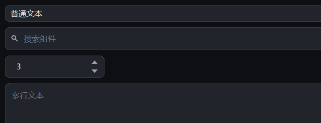

# 输入

{ loading=lazy }

## 作用

四个收文字的地方：单行输入、数字步进、带搜索回调的输入框、多行文本。

> 取值型控件同时支持 `set_value(...)` / `get_value()` 与简写 `set(...)` / `get()`，两者完全等价；下文统一用 `set_value` / `get_value`。

## CTkEntry

### 作用

单行输入框，回车可以触发回调，默认带右键菜单（剪切 / 复制 / 粘贴 / 全选）。
只读时能选中复制，但改不了。

### 参数

| 参数 | 类型 | 默认值 | 说明 |
| --- | --- | --- | --- |
| `master` | `tk.Misc` | 必填 | 父容器 |
| `placeholder_text` | `str` | `""` | 占位文字 |
| `width` / `height` | `int` | `200` / `38` | 尺寸 |
| `menu` | `bool` | `True` | 是否挂右键菜单 |
| `readonly` | `bool` | `False` | 只读 |

其余关键字透传给 CTk 的 `CTkEntry`（`font`、`border_width`、`text_color` 等）。

### 方法

| 方法 | 说明 |
| --- | --- |
| `set_value(text)` / `get_value()` | 写 / 读内容（等价于 `set()` / `get()`） |
| `append(text)` | 追加到末尾 |
| `clear()` | 清空 |
| `set_readonly(flag)` | 只读开关 |
| `unlocked()` | 临时解锁的上下文（见下） |
| `bind("<Return>", fn)` | 回车回调 |

### 示例

```python
entry = CTkEntry(card.body, placeholder_text="输入名称")
entry.pack(fill="x", padx=16, pady=(0, 12))
entry.bind("<Return>", lambda _e: print(entry.get_value()))

entry.set_value("初始值")
entry.set_readonly(True)          # 用户改不了，但程序还能写

with entry.unlocked():            # 需要程序写入时临时解锁，退出自动锁回
    entry.insert("end", "追加")
```

## Spinner

### 作用

数字输入框，右侧上下两个箭头各加减一步；也可以直接键入。

### 参数

| 参数 | 类型 | 默认值 | 说明 |
| --- | --- | --- | --- |
| `master` | `tk.Misc` | 必填 | 父容器 |
| `from_` | `float` | `0` | 最小值 |
| `to` | `float` | `100` | 最大值（到了就停住） |
| `increment` | `float` | `1` | 每次加减多少 |
| `value` | `float` | `None` | 初始值 |
| `as_int` | `bool` | `False` | 只允许整数 |
| `command` | `Callable[[float], None]` | `None` | 值变化回调 |
| `readonly` | `bool` | `False` | 只读 |

### 方法

| 方法 | 说明 |
| --- | --- |
| `get_value()` / `set_value(value)` | 读 / 写当前值（等价于 `get()` / `set()`） |
| `set_range(from_, to)` | 改范围 |
| `set_readonly(flag)` | 只读开关 |

### 示例

```python
count = Spinner(card.body, from_=1, to=20, value=1, as_int=True,
                command=lambda v: print("现在是", v))
count.pack(padx=16, pady=(0, 12))
```

## SearchBox

### 作用

带放大镜和清除按钮的搜索框；输入停顿 `delay` 毫秒后才回调，避免每敲一个字都查一次。

### 参数

| 参数 | 类型 | 默认值 | 说明 |
| --- | --- | --- | --- |
| `master` | `tk.Misc` | 必填 | 父容器 |
| `placeholder` | `str` | `"搜索"` | 占位文字 |
| `command` | `Callable[[str], None]` | `None` | 搜索回调，参数是当前文字 |
| `delay` | `int` | `300` | 防抖毫秒数 |
| `width` | `int` | `220` | 宽度 |
| `readonly` | `bool` | `False` | 只读 |

### 方法

| 方法 | 说明 |
| --- | --- |
| `set_value(text)` / `get_value()` | 写 / 读文字（等价于 `set()` / `get()`） |
| `clear()` | 清空并触发一次回调 |
| `search()` | 立刻触发回调，不等防抖 |
| `focus()` | 让输入框获得焦点 |

### 示例

```python
box = SearchBox(card.body, placeholder="搜组件名",
                command=lambda text: print("搜索", text))
box.pack(fill="x", padx=16, pady=(0, 12))
```

## TextArea

### 作用

多行文本；可选显示字数统计。只读时退化为可选中复制的展示框。

### 参数

| 参数 | 类型 | 默认值 | 说明 |
| --- | --- | --- | --- |
| `master` | `tk.Misc` | 必填 | 父容器 |
| `placeholder` | `str` | `""` | 占位文字 |
| `height` | `int` | `200` | 高度 |
| `show_counter` | `bool` | `True` | 右下角显示字数 |
| `on_change` | `Callable[[str], None]` | `None` | 内容变化回调 |
| `readonly` | `bool` | `False` | 只读 |

### 方法

| 方法 | 说明 |
| --- | --- |
| `set_value(text)` / `get_value()` | 写 / 读内容（等价于 `set()` / `get()`） |
| `clear()` | 清空 |
| `set_readonly(flag)` | 只读开关 |

### 示例

```python
area = TextArea(card.body, placeholder="写点什么…", height=120, show_counter=True)
area.pack(fill="x", padx=16, pady=(0, 12))
area.set_value("第一行\n第二行")
```
