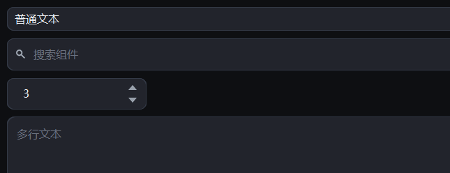

# 输入

{ loading=lazy }

## 作用

四个收文字的地方：单行输入、数字步进、带搜索回调的输入框、多行文本。

> 取值型控件统一用 `get()` 读、`set(...)` 写。

## CTkEntry

### 作用

单行输入框，回车可以触发回调，默认带右键菜单（剪切 / 复制 / 粘贴 / 全选）。
只读时能选中复制，但改不了。

### 参数

| 参数 | 类型 | 默认值 | 说明 |
| --- | --- | --- | --- |
| `master` | `tk.Misc` | 必填 | 父容器 |
| `placeholder_text` | `str` | `""` | 占位文字 |
| `placeholder` | `str` | `None` | 占位文字别名，等价于 `placeholder_text` |
| `password` | `bool` | `False` | 密码框，用圆点打码 |
| `width` / `height` | `int` | `200` / `38` | 尺寸 |
| `menu` | `bool` | `True` | 是否挂右键菜单 |
| `readonly` | `bool` | `False` | 只读 |

其余关键字透传给 CTk 的 `CTkEntry`（`font`、`border_width`、`text_color` 等）。

### 方法

| 方法 | 说明 |
| --- | --- |
| `set(text)` / `get()` | 写 / 读内容（等价于 `set()` / `get()`） |
| `append(text)` | 追加到末尾 |
| `clear()` | 清空 |
| `set_readonly(flag)` | 只读开关 |
| `unlocked()` | 临时解锁的上下文（见下） |
| `bind("<Return>", fn)` | 回车回调 |

### 示例

```python
entry = CTkEntry(card.body, placeholder_text="输入名称")
entry.pack(fill="x", padx=16, pady=(0, 12))
entry.bind("<Return>", lambda _e: print(entry.get()))

entry.set("初始值")
entry.set_readonly(True)          # 用户改不了，但程序还能写

pwd = CTkEntry(card.body, password=True, placeholder="密码")
pwd.pack(fill="x", padx=16, pady=(0, 12))

with entry.unlocked():            # 需要程序写入时临时解锁，退出自动锁回
    entry.insert("end", "追加")
```

## CompoundEntry

### 作用

前后缀固定的复合输入框：左边可以固定 `https://`，右边可以固定 `@qq.com`，
两边都传也行。固定文字只是展示，`get()` 只返回中间输入的部分；要连固定
部分一起提交，用 `get_full_value()`。

外框是 `CTkFrame`，套输入框的底色和描边，里面的 `CTkEntry` 透明、无描边，
视觉上和外框连成一块。点前缀 / 后缀文字也会把焦点交给输入框。

### 参数

| 参数 | 类型 | 默认值 | 说明 |
| --- | --- | --- | --- |
| `master` | `tk.Misc` | 必填 | 父容器 |
| `prefix` | `str` | `""` | 左侧固定文字，空字符串不显示 |
| `suffix` | `str` | `""` | 右侧固定文字，空字符串不显示 |
| `placeholder` | `str` | `""` | 输入框为空时的占位文字 |
| `width` | `int` | `260` | 整体宽度（像素） |
| `height` | `int` | `38` | 整体高度（像素） |
| `font` | `FontSpec` | `FONT_BODY` | 输入文字与固定文字的字体 |
| `menu` | `Any` | `True` | 右键菜单，含义同 `CTkEntry` |
| `readonly` | `bool` | `False` | 初始只读 |

### 方法

| 方法 | 说明 |
| --- | --- |
| `get()` | 中间的输入内容，不含固定部分 |
| `set(text)` | 写入输入内容 |
| `get()` | 同 `get()` |
| `get_text()` | 同 `get()` |
| `get_full_value()` | 前缀 + 输入 + 后缀 的完整字符串 |
| `set_full_value(value)` | 按完整值写入，自动去掉匹配的前后缀 |
| `set_readonly(flag)` | 只读：能选中、复制，不能改内容 |
| `set_enabled(flag)` | 禁用：输入框拒收键盘，固定文字变灰 |

### 示例

```python
from ctk_kit import CompoundEntry

url = CompoundEntry(card.body, prefix="https://", placeholder="example.com")
url.pack(fill="x", padx=16, pady=(0, 12))
url.get()               # "example.com"
url.get_full_value()    # "https://example.com"

mail = CompoundEntry(card.body, suffix="@qq.com", placeholder="输入 QQ 号")
mail.set_full_value("123456@qq.com")   # 自动剥掉后缀，输入框里是 123456
```

## Spinner

### 作用

数字输入框，右侧上下两个箭头各加减一步；也可以直接键入。

### 参数

| 参数 | 类型 | 默认值 | 说明 |
| --- | --- | --- | --- |
| `master` | `tk.Misc` | 必填 | 父容器 |
| `from_` | `float` | `0` | 最小值 |
| `to` | `float` | `100` | 最大值（到了就停住） |
| `increment` | `float` | `1` | 每次加减多少 |
| `value` | `float` | `None` | 初始值 |
| `as_int` | `bool` | `False` | 只允许整数 |
| `command` | `Callable[[float], None]` | `None` | 值变化回调 |
| `readonly` | `bool` | `False` | 只读 |

### 方法

| 方法 | 说明 |
| --- | --- |
| `get()` / `set(value)` | 读 / 写当前值（等价于 `get()` / `set()`） |
| `set_range(from_, to)` | 改范围 |
| `set_readonly(flag)` | 只读开关 |

### 示例

```python
count = Spinner(card.body, from_=1, to=20, value=1, as_int=True,
                command=lambda v: print("现在是", v))
count.pack(padx=16, pady=(0, 12))
```

## SearchBox

### 作用

带放大镜和清除按钮的搜索框；输入停顿 `delay` 毫秒后才回调，避免每敲一个字都查一次。

### 参数

| 参数 | 类型 | 默认值 | 说明 |
| --- | --- | --- | --- |
| `master` | `tk.Misc` | 必填 | 父容器 |
| `placeholder` | `str` | `"搜索"` | 占位文字 |
| `command` | `Callable[[str], None]` | `None` | 搜索回调，参数是当前文字 |
| `delay` | `int` | `300` | 防抖毫秒数 |
| `width` | `int` | `220` | 宽度 |
| `readonly` | `bool` | `False` | 只读 |

### 方法

| 方法 | 说明 |
| --- | --- |
| `set(text)` / `get()` | 写 / 读文字（等价于 `set()` / `get()`） |
| `clear()` | 清空并触发一次回调 |
| `search()` | 立刻触发回调，不等防抖 |
| `focus()` | 让输入框获得焦点 |

### 示例

```python
box = SearchBox(card.body, placeholder="搜组件名",
                command=lambda text: print("搜索", text))
box.pack(fill="x", padx=16, pady=(0, 12))
```

## TextArea

### 作用

多行文本；可选显示字数统计。只读时退化为可选中复制的展示框。

### 参数

| 参数 | 类型 | 默认值 | 说明 |
| --- | --- | --- | --- |
| `master` | `tk.Misc` | 必填 | 父容器 |
| `placeholder` | `str` | `""` | 占位文字 |
| `height` | `int` | `200` | 高度 |
| `show_counter` | `bool` | `True` | 右下角显示字数 |
| `on_change` | `Callable[[str], None]` | `None` | 内容变化回调 |
| `readonly` | `bool` | `False` | 只读 |

### 方法

| 方法 | 说明 |
| --- | --- |
| `set(text)` / `get()` | 写 / 读内容（等价于 `set()` / `get()`） |
| `clear()` | 清空 |
| `set_readonly(flag)` | 只读开关 |

### 示例

```python
area = TextArea(card.body, placeholder="写点什么…", height=120, show_counter=True)
area.pack(fill="x", padx=16, pady=(0, 12))
area.set("第一行\n第二行")
```
