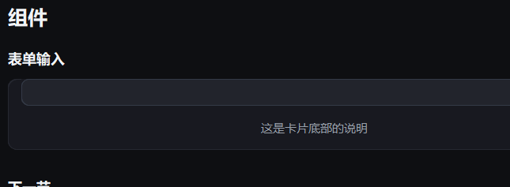

# 布局

{ loading=lazy }

## 作用

搭页面骨架的几个容器和文字：卡片装内容，滚动容器装长列表，页头放标题，
小标题分段，三行辅助文字负责说明。

## Card

### 作用

一块带圆角和标题的白色 / 深色面板，内容区通过 `.body` 拿到。

### 参数

| 参数 | 类型 | 默认值 | 说明 |
| --- | --- | --- | --- |
| `master` | `tk.Misc` | 必填 | 父容器 |
| `title` | `str` | `""` | 标题，空则不显示标题行 |

其余关键字透传给 CTk 的 `CTkFrame`（`fg_color`、`border_width`、`corner_radius` 等）。

### 属性 / 方法

| 名称 | 说明 |
| --- | --- |
| `body` | 内容容器（属性，不是方法）；卡片里的控件都建在它上面 |
| `row(index, **kwargs)` | 取第 `index` 行（自动建），用来做左右分栏 |
| `apply_theme()` | 按当前令牌重画（换色后自动调用） |

### 示例

```python
card = Card(area, title="账号")
card.pack(fill="x", padx=24, pady=(0, 12))

CTkEntry(card.body).pack(fill="x", padx=16, pady=(0, 12))
PrimaryButton(card.row(1), "保存").pack(side="right", padx=(0, 16))
```

## Scrollable

### 作用

可竖向滚动的内容区；内容超过高度时自动出现滚动条，`auto_hide=True` 时
内容够短就把滚动条藏起来。

### 参数

| 参数 | 类型 | 默认值 | 说明 |
| --- | --- | --- | --- |
| `master` | `tk.Misc` | 必填 | 父容器 |
| `auto_hide` | `bool` | `True` | 不需要滚动时隐藏滚动条 |

其余关键字透传给内部容器（`width`、`height`、`fg_color` 等）。

### 方法

| 方法 | 说明 |
| --- | --- |
| `suspend_scrollbar()` | 暂时冻结滚动条，批量加内容时避免反复重算 |
| `resume_scrollbar()` | 恢复并补一次布局 |

### 示例

```python
scroll = Scrollable(area, auto_hide=True)
scroll.pack(fill="both", expand=True, padx=24)

scroll.suspend_scrollbar()
try:
    for index in range(20):
        Label(scroll, f"第 {index + 1} 行").pack(fill="x", pady=4)
finally:
    scroll.resume_scrollbar()
```

## PageHeader

### 作用

页面最上方的大标题，右侧可以放一行说明。

### 参数

| 参数 | 类型 | 默认值 | 说明 |
| --- | --- | --- | --- |
| `master` | `tk.Misc` | 必填 | 父容器 |
| `title` | `str` | 必填 | 大标题文字 |

### 属性

| 属性 | 说明 |
| --- | --- |
| `info` | 右侧的灰字标签，`header.info.configure(text="…")` 改它 |

### 示例

```python
header = PageHeader(area, "组件")     # 构造时已自动 pack(fill="x")
header.info.configure(text="当前：Dark")
```

## SectionTitle

### 作用

卡片之间的小标题，比 `PageHeader` 小一号。

### 参数

| 参数 | 类型 | 默认值 | 说明 |
| --- | --- | --- | --- |
| `master` | `tk.Misc` | 必填 | 父容器 |
| `text` | `str` | 必填 | 标题文字 |

```python
SectionTitle(area, "表单输入")        # 同样自动 pack(fill="x")
```

## FieldLabel / HintLabel / Label

### 作用

三行不同用途的文字：`FieldLabel` 是表单左侧的字段名，`HintLabel` 是卡片底部
的浅色说明，`Label` 是普通正文。

### 参数

| 参数 | 类型 | 默认值 | 说明 |
| --- | --- | --- | --- |
| `master` | `tk.Misc` | 必填 | 父容器 |
| `text` | `str` | `""` | 文字 |
| `width` | `int` | `None` | 固定宽度；`FieldLabel` 默认 112，让各行对齐 |

### 方法

| 方法 | 说明 |
| --- | --- |
| `set_text(text)` | 改文字 |
| `get_text()` | 读文字 |

### 示例

```python
FieldLabel(row, "用户名").pack(side="left")
Label(row, "只会显示给管理员").pack(side="left", padx=8)
HintLabel(card.body, "改动保存后立即生效").pack(padx=16, pady=(0, 12))
```
