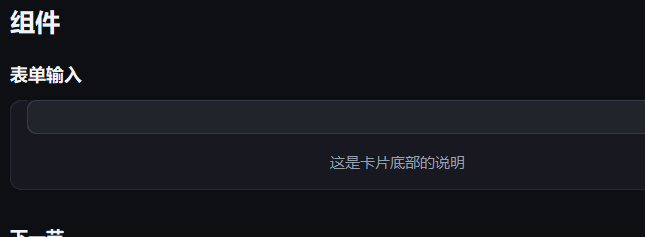

# 布局

{ loading=lazy }

## 作用

搭页面骨架的几个容器和文字：卡片装内容，滚动容器装长列表，页头放标题，
小标题分段，三行辅助文字负责说明。

## Card

### 作用

一块带圆角和标题的白色 / 深色面板，内容区通过 `.body` 拿到。

### 参数

| 参数 | 类型 | 默认值 | 说明 |
| --- | --- | --- | --- |
| `master` | `tk.Misc` | 必填 | 父容器 |
| `title` | `str` | `""` | 标题，空则不显示标题行 |
| `inside_title` | `str` | `""` | 传了就在卡片内部顶部画标题，并带一条分隔线；不传标题在卡片外上方 |

其余关键字透传给 CTk 的 `CTkFrame`（`fg_color`、`border_width`、`corner_radius` 等）。

### 属性 / 方法

| 名称 | 说明 |
| --- | --- |
| `body` | 内容容器（属性，不是方法）；卡片里的控件都建在它上面 |
| `row(index, **kwargs)` | 取第 `index` 行（自动建，返回 `Row`），用来做左右分栏 |
| `apply_theme()` | 按当前令牌重画（换色后自动调用） |

### 示例

```python
card = Card(area, title="账号")
card.pack(fill="x", padx=24, pady=(0, 12))

CTkEntry(card.body).pack(fill="x", padx=16, pady=(0, 12))
row = card.row(1)
PrimaryButton(row, "保存").pack(side="right")

# 标题放进卡片内部：标题行 + 分隔线都在卡片里
panel = Card(area, inside_title="账号信息")
panel.pack(fill="x", padx=24, pady=(0, 12))
```

## CTkFrame / Frame

### 作用

两个容器都带 `row()`，写法和 `Card` 一样，按编号分行、自动分配行距；区别只在底色：
`ctk_kit.CTkFrame` 保留主题默认底色，`Frame` 默认透明。

### 参数

与 CTk 的 `CTkFrame` 完全一致；`Frame` 只是把 `fg_color` 的默认值改成 `"transparent"`。

### 方法

| 名称 | 说明 |
| --- | --- |
| `row(index, **kwargs)` | 与 `Card.row` 相同：取第 `index` 行（自动建，返回 `Row`） |

### 示例

```python
box = Frame(page, fg_color=COLOR_CARD)
box.pack(fill="x", padx=24, pady=(0, 12))

FieldLabel(box.row(1), "用户名").pack(side="left", anchor="nw")
CTkEntry(box.row(1), placeholder="用户名").pack(
    side="left", fill="x", expand=True, padx=(8, 0)
)
SecondaryButton(box.row(2), "取消").pack(side="right")
```

## Row

### 作用

卡片里的一行。字段名用 `FieldLabel` 放在行首，控件直接建在 `row` 上并 `pack` 到右侧；不需要字段名时直接把控件 `pack` 到 `row` 上。`Card.row(index)`、`CTkFrame.row(index)`、`Frame.row(index)` 返回的都是它。

### 参数

| 参数 | 类型 | 默认值 | 说明 |
| --- | --- | --- | --- |
| `master` | `tk.Misc` | 必填 | 父容器 |

其余关键字透传给 `CTkFrame`。

### 示例

```python
row = card.row(1, fill="x", padx=16, pady=(14, 8))
FieldLabel(row, "昵称").pack(side="left", anchor="nw")
entry = CTkEntry(row, placeholder="输入昵称")
entry.pack(side="left", fill="x", expand=True, padx=(8, 0))

row = card.row(2)
PrimaryButton(row, "保存").pack(side="left")
SecondaryButton(row, "取消").pack(side="left", padx=(10, 0))
SecondaryButton(row, "更多").pack(side="right")
```

`pack()` / `grid()` / `place()` 现在返回控件本身，也可以直接连着写：

```python
kind = DropField(row, values=["全部", "账号"]).pack(
    side="left", fill="x", expand=True, padx=(8, 0)
)
kind.get()
```

## Scrollable

### 作用

可竖向滚动的内容区；内容超过高度时自动出现滚动条，`auto_hide=True` 时
内容够短就把滚动条藏起来。

### 参数

| 参数 | 类型 | 默认值 | 说明 |
| --- | --- | --- | --- |
| `master` | `tk.Misc` | 必填 | 父容器 |
| `auto_hide` | `bool` | `True` | 不需要滚动时隐藏滚动条 |

其余关键字透传给内部容器（`width`、`height`、`fg_color` 等）。

### 方法

| 方法 | 说明 |
| --- | --- |
| `suspend_scrollbar()` | 暂时冻结滚动条，批量加内容时避免反复重算 |
| `resume_scrollbar()` | 恢复并补一次布局 |

### 示例

```python
scroll = Scrollable(area, auto_hide=True)
scroll.pack(fill="both", expand=True, padx=24)

scroll.suspend_scrollbar()
try:
    for index in range(20):
        Label(scroll, f"第 {index + 1} 行").pack(fill="x", pady=4)
finally:
    scroll.resume_scrollbar()
```

## PageHeader

### 作用

页面最上方的大标题，右侧可以放一行说明。

### 参数

| 参数 | 类型 | 默认值 | 说明 |
| --- | --- | --- | --- |
| `master` | `tk.Misc` | 必填 | 父容器 |
| `title` | `str` | 必填 | 大标题文字 |

### 属性

| 属性 | 说明 |
| --- | --- |
| `info` | 右侧的灰字标签（`ctk.Label`），`header.info.set_text("…")` 改它 |

### 示例

```python
header = PageHeader(area, "组件")     # 构造时已自动 pack(fill="x")
header.info.set_text("当前：Dark")
```

## SectionTitle

### 作用

卡片之间的小标题，比 `PageHeader` 小一号。

### 参数

| 参数 | 类型 | 默认值 | 说明 |
| --- | --- | --- | --- |
| `master` | `tk.Misc` | 必填 | 父容器 |
| `text` | `str` | 必填 | 标题文字 |

```python
SectionTitle(area, "表单输入")        # 同样自动 pack(fill="x")
```

## FieldLabel / HintLabel / Label

### 作用

三行不同用途的文字：`FieldLabel` 是表单左侧的字段名，`HintLabel` 是卡片底部
的浅色说明，`Label` 是普通正文。

### 参数

| 参数 | 类型 | 默认值 | 说明 |
| --- | --- | --- | --- |
| `master` | `tk.Misc` | 必填 | 父容器 |
| `text` | `str` | `""` | 文字 |
| `width` | `int` | `None` | 固定宽度；`FieldLabel` 默认 112，让各行对齐 |

### 方法

| 方法 | 说明 |
| --- | --- |
| `set_text(text)` | 改文字 |
| `get_text()` | 读文字 |

### 示例

```python
row = card.row(1)
FieldLabel(row, "用户名").pack(side="left")
Label(row, "只会显示给管理员").pack(side="left", padx=(8, 0))
HintLabel(card.body, "改动保存后立即生效").pack(padx=16, pady=(0, 12))
```
