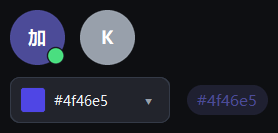

# 媒体与颜色

{ loading=lazy }

## 作用

图片、头像、轮播和取色：都是「围绕一张图或一个颜色」的控件。

## Avatar

### 作用

圆形头像：可以显示图片，也可以只显示首字母；右下角可以带状态点。

### 参数

| 参数 | 类型 | 默认值 | 说明 |
| --- | --- | --- | --- |
| `master` | `tk.Misc` | 必填 | 父容器 |
| `text` | `str` | `""` | 没有图片时显示的文字（一般给首字母） |
| `image` | `str` / `PIL.Image` | `None` | 图片路径或图片对象 |
| `size` | `int` | `40` | 直径 |
| `status` | `str` | `None` | 右下角状态点：`"online"` / `"busy"` / `"away"` |

### 方法

| 方法 | 说明 |
| --- | --- |
| `set_text(text)` | 改文字 |
| `set_image(image)` | 换图片 |
| `set_status(status)` | 改状态点 |

### 示例

```python
Avatar(card.row(0), text="加", size=36, status="online").pack(side="left", padx=8)
```

## ImageViewer

### 作用

带缩放和适配模式的图片查看器。

### 参数

| 参数 | 类型 | 默认值 | 说明 |
| --- | --- | --- | --- |
| `master` | `tk.Misc` | 必填 | 父容器 |
| `height` | `int` | `320` | 高度 |
| `min_zoom` / `max_zoom` | `float` | `1.0` / `8.0` | 缩放范围 |
| `empty_text` | `str` | `"还没有图片"` | 空状态文字 |
| `on_zoom` | `Callable[[float], None]` | `None` | 缩放回调 |

### 方法

| 方法 | 说明 |
| --- | --- |
| `set_image(source)` | 换图片（路径或 `PIL.Image`） |
| `fit(mode)` | 改适配模式：`contain` / `cover` / `fill` |
| `set_zoom(scale)` / `zoom(delta)` | 设置 / 增减缩放 |

### 示例

```python
viewer = ImageViewer(card.body, height=220)
viewer.pack(fill="both", expand=True, padx=16, pady=(0, 12))
viewer.set_image("你的图片.png")   # 换成实际路径
viewer.zoom(0.2)
```

## Carousel

### 作用

一次显示一张的轮播，底部小圆点指示第几张，可自动播放。

### 参数

| 参数 | 类型 | 默认值 | 说明 |
| --- | --- | --- | --- |
| `master` | `tk.Misc` | 必填 | 父容器 |
| `items` | `Sequence` | `()` | 图片路径或图片对象列表 |
| `height` | `int` | `180` | 高度 |
| `autoplay` | `int` | `0` | 自动切换间隔（毫秒），`0` 表示不自动播放 |
| `command` | `Callable[[int], None]` | `None` | 切换回调 |

### 方法

| 方法 | 说明 |
| --- | --- |
| `show(index, notify=False)` | 显示第几张 |
| `next()` / `prev()` | 下一张 / 上一张 |
| `start()` / `stop()` | 开始 / 停止自动播放 |

### 示例

```python
carousel = Carousel(card.body, items=["a.png", "b.png"], height=200, autoplay=3000)
carousel.pack(fill="x", padx=16, pady=(0, 12))
carousel.next()
```

## ColorPicker

### 作用

一个色块（或一行色块），点开弹出取色面板；也可以只读展示当前颜色。

### 参数

| 参数 | 类型 | 默认值 | 说明 |
| --- | --- | --- | --- |
| `master` | `tk.Misc` | 必填 | 父容器 |
| `value` | `str` | `"#2563eb"` | 初始颜色 |
| `colors` | `Sequence[str]` | `None` | 可选色板；不传用内置色板 |
| `command` | `Callable[[str], None]` | `None` | 选色回调 |
| `width` | `int` | `130` | 宽度 |
| `readonly` | `bool` | `False` | 只读时点不开 |

### 方法

| 方法 | 说明 |
| --- | --- |
| `get()` / `set(color)` | 读 / 写当前颜色 |
| `open()` / `close()` | 开 / 关取色面板 |
| `set_readonly(flag)` | 只读开关 |

### 示例

```python
picker = ColorPicker(card.body, value="#4f46e5",
                     colors=["#4f46e5", "#10b981", "#ef4444"])
picker.pack(anchor="w", padx=16, pady=(0, 12))
print(picker.get())
```

## ColorDialog

### 作用

独立的取色对话框，`show()` 阻塞返回选中的颜色，取消返回 `None`。

### 参数

| 参数 | 类型 | 默认值 | 说明 |
| --- | --- | --- | --- |
| `master` | `tk.Misc` | 必填 | 父窗口 |
| `value` | `str` | `"#4f46e5"` | 初始颜色 |
| `title` | `str` | `"选择颜色"` | 标题 |

### 方法

| 方法 | 说明 |
| --- | --- |
| `show()` | 弹出并返回颜色字符串或 `None` |

### 示例

```python
picker = ColorPicker(card.body, value="#4f46e5")
color = ColorDialog(app, value=picker.get()).show()
if color:
    picker.set(color)
```
