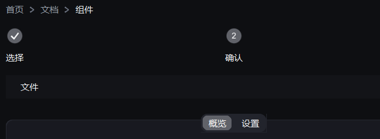

# 导航

{ loading=lazy }

## 作用

页面之内的导航：标签页、步骤条、向导、面包屑、菜单栏。

## Tabs

### 作用

一排标签 + 一个内容区，切换标签时换内容。

### 参数

| 参数 | 类型 | 默认值 | 说明 |
| --- | --- | --- | --- |
| `master` | `tk.Misc` | 必填 | 父容器 |
| `values` | `Sequence[str]` | `()` | 各标签文字 |
| `command` | `Callable[[str], None]` | `None` | 切换回调 |
| `width` / `height` | `int` | `420` / `260` | 尺寸 |

### 方法

| 方法 | 说明 |
| --- | --- |
| `tab(name)` | 取某个标签的内容容器（不存在就建） |
| `set(name)` | 切到某个标签 |
| `add(name)` | 追加一个标签 |
| `current()` | 当前标签名 |

### 示例

```python
tabs = Tabs(area, values=["概览", "设置"])
tabs.pack(fill="both", expand=True, padx=24)

Label(tabs.tab("概览"), "这里是概览").pack(padx=12, pady=12)
tabs.set("设置")
```

## Steps

### 作用

横向步骤条：已完成的打勾、当前的高亮、后续的灰着。

### 参数

| 参数 | 类型 | 默认值 | 说明 |
| --- | --- | --- | --- |
| `master` | `tk.Misc` | 必填 | 父容器 |
| `steps` | `Sequence[str]` | `()` | 各步文字 |
| `current` | `int` | `1` | 当前第几步（从 1 开始） |
| `clickable` | `bool` | `False` | 是否允许点某一步跳过去 |
| `command` | `Callable[[int], None]` | `None` | 点击回调 |

### 方法

| 方法 | 说明 |
| --- | --- |
| `get()` / `set_current(n)` | 读 / 写当前步 |
| `set_value(n)` | 同 `set_current` |

### 示例

```python
steps = Steps(area, steps=["选择", "确认", "完成"], current=1)
steps.pack(fill="x", padx=24, pady=(0, 12))
steps.set_current(2)
```

## Wizard

### 作用

多步向导：每步一个页面内容，自带「上一步 / 下一步」，最后一步给完成回调。

### 参数

| 参数 | 类型 | 默认值 | 说明 |
| --- | --- | --- | --- |
| `master` | `tk.Misc` | 必填 | 父容器 |
| `steps` | `Sequence[(标题, 构建函数)]` | `()` | 构建函数签名是 `fn(parent, wizard)`，往 `parent` 里放这一页的控件 |
| `command` | `Callable[[Wizard], None]` | `None` | 最后一页点「完成」时触发，参数是向导自身 |

### 方法

| 方法 | 说明 |
| --- | --- |
| `get()` | 当前第几步（从 1 开始） |
| `next()` / `back()` | 前进 / 后退 |
| `go_to(n)` | 跳到第 n 步 |

### 示例

```python
def build_name(box, wizard):
    CTkEntry(box, placeholder_text="项目名").pack(fill="x", padx=12, pady=12)

wizard = Wizard(area, steps=[("起名", build_name), ("确认", lambda box, w: None)])
wizard.pack(fill="both", expand=True, padx=24)
```

## Breadcrumb

### 作用

一条路径式导航：`首页 › 文档 › 组件`，点某一级可以跳回去。

### 参数

| 参数 | 类型 | 默认值 | 说明 |
| --- | --- | --- | --- |
| `master` | `tk.Misc` | 必填 | 父容器 |
| `items` | `Sequence[str]` | `()` | 各级文字 |
| `separator` | `str` | `"›"` | 分隔符 |
| `command` | `Callable[[int], None]` | `None` | 点击回调，参数是第几级（0 开始） |

### 方法

| 方法 | 说明 |
| --- | --- |
| `set_items(items)` | 换整条路径 |
| `get_items()` | 读当前路径 |

### 示例

```python
crumb = Breadcrumb(area, items=["首页", "文档", "组件"],
                   command=lambda i: print("点了第", i + 1, "级"))
crumb.pack(anchor="w", padx=24)
```

## MenuBar

### 作用

横向菜单栏，菜单之间可以插输入框、按钮、搜索框。

### 参数

| 参数 | 类型 | 默认值 | 说明 |
| --- | --- | --- | --- |
| `master` | `tk.Misc` | 必填 | 父容器 |
| `items` | `Sequence[(菜单名, 菜单项列表)]` | `()` | 菜单项是 `(文字, 回调)`，`"-"` 是分隔线 |
| `height` | `int` | `34` | 整条栏的高度 |

### 方法

| 方法 | 说明 |
| --- | --- |
| `add_menu(label, entries)` | 追加一个菜单 |
| `add_entry(placeholder, ...)` | 加输入框（回车触发 `command`） |
| `add_button(text, command, ...)` | 加按钮 |
| `add_search(placeholder, ...)` | 加搜索框 |
| `add_widget(widget, side)` | 放已建好的控件 |
| `close()` | 收起所有下拉 |

### 示例

```python
bar = MenuBar(card.body, items=[
    ("文件", [("新建", lambda: print("新建")), ("-", None),
             ("退出", lambda: print("退出"))]),
])
bar.pack(fill="x")

bar.add_entry(placeholder="跳转到…", command=lambda: print("回车"))   # 靠右
bar.add_button("设置", command=lambda: print("设置"))               # 靠右
```
