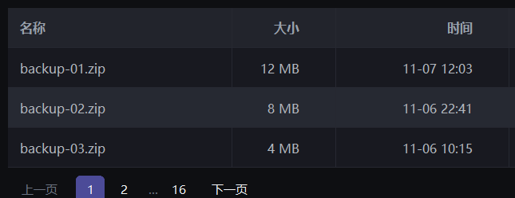

# 表格与列表

{ loading=lazy }

## 作用

展示「多条数据」的控件：表格、可增删改表格、树、懒加载列表、页码条。

## Table

### 作用

带表头的表格，隔行淡底；超过 `max_visible_rows` 后滚动，也可以分页。
拖列边界可以改宽：变宽时从最右列开始挤压，挤到最小宽度（60）后继续挤左一列。

### 参数

| 参数 | 类型 | 默认值 | 说明 |
| --- | --- | --- | --- |
| `master` | `tk.Misc` | 必填 | 父容器 |
| `columns` | `Sequence[str \| (标题, 宽度) \| (标题, 宽度, 对齐)]` | 必填 | 只写列名时宽度自动分配；宽度传 `None` 表示吃掉剩余宽度 |
| `row_height` | `int` | `40` | 行高 |
| `max_visible_rows` | `int` | `8` | 最多显示几行 |
| `page_size` | `int` | `0` | 每页行数，大于 0 时出现分页条 |
| `empty_text` | `str` | `"暂无数据"` | 空数据提示 |
| `command` | `Callable[[int], None]` | `None` | 点击行回调，参数是该行在全量数据里的下标 |

### 方法

| 方法 | 说明 |
| --- | --- |
| `set_rows(rows)` | 整批替换数据；行可以是序列，也可以是按列标题取值的字典 |
| `add_row(row)` | 追加一行（序列或字典） |
| `remove_row(index)` | 删除指定下标的行 |
| `get_selected()` | 当前选中行下标；没有选中返回 `None` |
| `select(index)` | 选中一行（分页时会自动翻到对应页），传 `None` 取消 |
| `clear_selection()` | 取消选中 |
| `row_at(y)` | 内容区画布坐标 `y` 对应的行下标（全量下标）；空白处返回 `None` |
| `set_page(n)` | 跳页 |
| `pages()` / `page()` | 总页数 / 当前页 |

### 示例

```python
table = Table(
    card.body,
    ["名称", ("大小", 90, "e"), ("时间", None, "e")],
    max_visible_rows=6,
)
table.set_rows([
    {"名称": "backup-01.zip", "大小": "12 MB", "时间": "2026-11-07 12:03"},
    {"名称": "backup-02.zip", "大小": "8 MB", "时间": "2026-11-06 22:41"},
])
table.pack(fill="x", padx=16, pady=(0, 12))
```

## CrudTable

### 作用

在 `Table` 上内置增删改：左键选中，右键「向上添加 / 向下添加 / 编辑 / 删除」，
添加和编辑共用自动生成的表单窗，删除带确认。添加只有点「保存」才写入，
第一列不能为空。

### 参数

| 参数 | 类型 | 默认值 | 说明 |
| --- | --- | --- | --- |
| `master` | `tk.Misc` | 必填 | 父容器 |
| `columns` | `Sequence[tuple]` | 必填 | 与 `Table` 相同的列定义；标题同时用作表单字段名 |
| `rows` | `list` | `[]` | 数据列表（二维）；控件直接读写这个 list，不复制 |
| `new_row` | `Sequence[str]` | 全空 | 添加时的初始值，长度要和列数一致 |
| `hint` | `bool` | `True` | 是否显示「共 N 条 / 已选中」提示 |
| `max_visible_rows` / `empty_text` | — | 同 `Table` | 透传给内部表格 |
| `on_change` | `Callable[[list], None]` | `None` | 增删改成功后回调，参数是 `rows` 本身 |

### 方法

| 方法 | 说明 |
| --- | --- |
| `set_rows(rows)` | 换一份数据；之后的操作作用在新列表上 |
| `refresh(select_index=None)` | 按当前 `rows` 重画，可顺便选中一行 |
| `table` | 内部 `Table`，需要分页、只读选中时直接用它 |

### 示例

```python
members = [
    ["陈一", "产品", "产品经理", "chenyi@example.com"],
    ["林二", "设计", "交互设计师", "liner@example.com"],
]
table = CrudTable(
    page,
    columns=[("姓名", 130), ("部门", 140), ("角色", 160), ("邮箱", None)],
    rows=members,
    new_row=["新成员", "", "", ""],
)
table.pack(fill="both", expand=True)
```

## TreeView

### 作用

带表头的树：节点可以展开 / 收起，每个节点还能带几列附加数据。

### 参数

| 参数 | 类型 | 默认值 | 说明 |
| --- | --- | --- | --- |
| `master` | `tk.Misc` | 必填 | 父容器 |
| `columns` | `Sequence[str]` | `()` | 除树列之外的列标题 |
| `height` | `int` | `8` | 可见行数 |
| `command` | `Callable[[str], None]` | `None` | 选中回调，参数是 iid |

### 方法

| 方法 | 说明 |
| --- | --- |
| `insert(parent="", iid=None, *, text="", values=(), open=False)` | 插一行，返回 iid |
| `delete(iid)` | 删掉该行和子节点 |
| `clear()` | 清空 |
| `get_selected()` | 当前选中的 iid |
| `expand_all()` / `collapse_all()` | 全部展开 / 收起 |

### 示例

```python
tree = TreeView(card.body, columns=("大小", "类型"), height=6)
root = tree.insert(text="文档")
tree.insert(root, text="a.txt", values=("2 KB", "文本"))
tree.pack(fill="x", padx=16, pady=(0, 12))
```

## LazyList

### 作用

滚到底才继续建下一条的列表；一屏几百条也不卡，适合日志、搜索结果。

### 参数

| 参数 | 类型 | 默认值 | 说明 |
| --- | --- | --- | --- |
| `master` | `tk.Misc` | 必填 | 父容器 |
| `render_card` | `Callable[[容器, 数据], 控件]` | 必填 | 往一个空容器里画一条，**返回这张卡的顶层控件**（由列表负责摆放） |
| `first_batch` | `int` | `12` | 首屏建几条 |
| `load_more` | `int` | `8` | 到底再建几条 |
| `load_threshold` | `float` | `0.92` | 滚到 92% 处开始续建 |
| `on_load` | `Callable[[int, int], None]` | `None` | 每加载一批回调 `(已加载数, 总数)`，可用来显示进度；给了 `item_height` 的虚拟模式下是已建卡片数 |

### 方法

| 方法 | 说明 |
| --- | --- |
| `render(items)` | 重画列表 |
| `reset()` | 回到首屏 |
| `invalidate()` | 强制下次重建 |
| `show_hint(text)` | 空列表时显示一句提示 |

### 示例

```python
def render(box, item):
    return Label(box, item["name"])

records = [{"name": "第一条"}, {"name": "第二条"}]
lst = LazyList(card.body, render, first_batch=10)
lst.render(records)
lst.pack(fill="both", expand=True)
```

## Pagination

### 作用

`‹ 1 2 3 ›` 页码条；可以单独用，也可以和 `Table` 配合。

### 参数

| 参数 | 类型 | 默认值 | 说明 |
| --- | --- | --- | --- |
| `master` | `tk.Misc` | 必填 | 父容器 |
| `total` | `int` | `0` | 总条数 |
| `page_size` | `int` | `10` | 每页条数 |
| `current` | `int` | `1` | 当前页 |
| `command` | `Callable[[int], None]` | `None` | 翻页回调 |

### 方法

| 方法 | 说明 |
| --- | --- |
| `set_page(n)` | 跳页（超出范围会夹回） |
| `set_total(n)` | 改总条数 |
| `pages()` / `page()` | 总页数 / 当前页 |

### 示例

```python
pager = Pagination(card.body, total=128, page_size=10,
                   command=lambda p: load_page(p))
pager.pack(fill="x", padx=16, pady=(0, 12))
```
